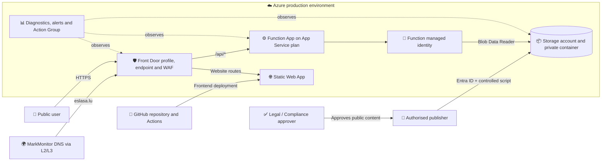
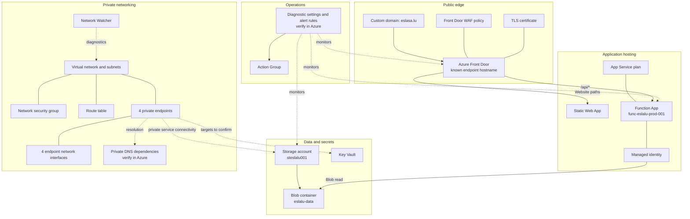
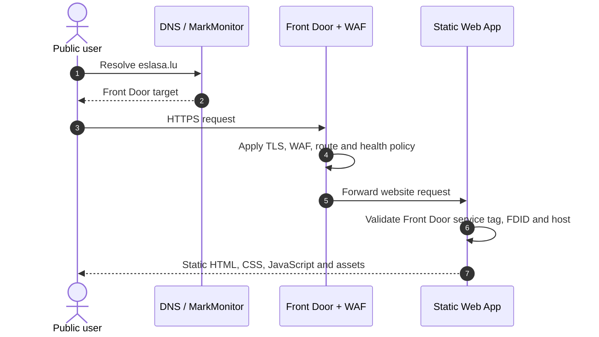
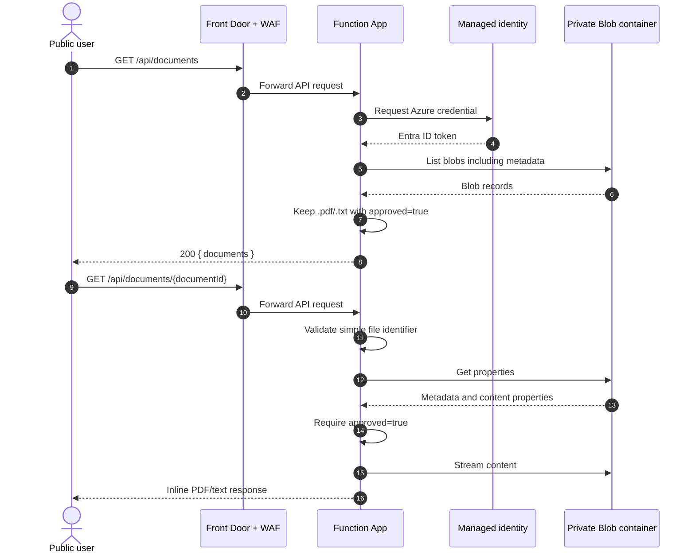
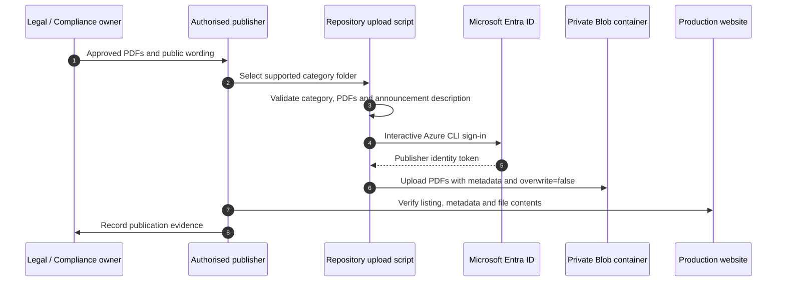

## 🎯 Purpose and scope
---
  

This document describes the production architecture of the Esla S.A. investor-relations website: application components, Azure resources, trust boundaries, request and publication flows, security controls, and known constraints.

  

Exact production values and fields requiring control-plane verification are maintained in [⚙️ Infrastructure Configuration Reference](/ADMINISTERED-WEBSITES/WEBSITES-\(Azure\)/Architecture/⚙️-Infrastructure-Configuration-Reference). Deployment procedures are intentionally kept in the dedicated website and Function guides.

[[_TOC_]]
  

## 🌐 System context
---
  

  

### Architectural principles

  

1. **Edge first:** Azure Front Door is the intended public entry point.

2. **Static presentation:** the browser receives build-free HTML, CSS, and JavaScript.

3. **Private data plane:** the browser never connects directly to Blob Storage.

4. **Credential-free application access:** the Function uses managed identity and Azure RBAC.

5. **Explicit publication:** only supported blobs with `approved=true` are public.

6. **Independent delivery:** frontend, Function, documents, and infrastructure follow separate controlled release paths.

7. **No invented configuration:** values absent from source must be verified in Azure or authoritative IaC.

  

## 🧩 Logical component model
---
  

| Layer | Component | Responsibility |
| --- | --- | --- |
| Edge | Azure Front Door | TLS termination, custom domain, origin health, and path-based routing |
| Edge security | Front Door WAF policy | Managed and custom request filtering at the public edge |
| Presentation | Azure Static Web Apps | Serves files from `app/` and restricts origin access to the configured Front Door |
| Client | `main.js` and `documents-api.js` | Navigation, search, API requests, category grouping, and document links |
| API | Azure Function App | Lists approved documents and streams approved content |
| Identity | Function managed identity | Authenticates to Blob Storage without embedded keys or SAS tokens |
| Data | Azure Storage account and Blob container | Stores publications and public metadata in a private container |
| Delivery | GitHub and GitHub Actions | Source review, preview environments, and production frontend deployment |
| Publishing | PowerShell upload workflow and Azure CLI | Uploads approved PDFs using publisher Entra ID permissions |
| Operations | Azure diagnostics, alerts, and Action Group | Observability, notification, and incident initiation |
| Domain | MarkMonitor through L2/L3 | Domain registration and controlled DNS changes |
  

## ☁️ Azure resource topology
---
  

The supplied project inventory contains the following resources. Only names present in source are shown; all other names and IDs must be verified in Azure.

  

  

| Resource | Quantity / known value | Architectural role | Verification status |
| --- | --- | --- | --- |
| Front Door profile and endpoint | Hostname recorded in configuration reference | Public edge and route owner | Endpoint hostname known; profile name and SKU unverified |
| Front Door WAF policy | 1 identified | Edge protection | Name, mode, rule sets, and exclusions unverified |
| Custom domain and certificate | `eslasa.lu` | Public HTTPS identity | Domain known; certificate state and renewal owner require operational verification |
| Static Web App | 1 identified | Static frontend origin | Name, default hostname, SKU, and resource ID unverified |
| Function App | `func-eslalu-prod-001` | Read-only document API | Name known; resource group, region, identity ID, and network settings unverified |
| App Service plan | 1 identified | Function compute | Name, operating system, SKU, and scale settings unverified |
| Storage account | `steslalu001` from publishing source | Document storage | Script target known; production Function setting must be compared in Azure |
| Blob container | `eslalu-data` from publishing source | Publication collection | Script target known; privacy, recovery, and lifecycle controls unverified |
| Key Vault | 1 identified | Platform-managed secrets or certificates where configured | Name, access model, and consumers unverified |
| Virtual network | 1 identified | Private network boundary | Name, address space, and subnets unverified |
| Network security group | 1 identified | Network traffic policy | Name, associations, and rules unverified |
| Route table | 1 identified | Subnet routing | Name, association, and routes unverified |
| Private endpoints | 4 identified | Private service connectivity | Targets, subresources, IPs, subnets, and approval states unverified |
| Private endpoint NICs | 4 identified | Network interfaces for private endpoints | Names and IP configurations unverified |
| Private DNS zones and links | Required where private endpoints are used; not confirmed in supplied inventory | Private endpoint name resolution | Presence and mappings unverified |
| Network Watcher | 1 identified | Network diagnostics | Region, flow logs, and enabled capabilities unverified |
| Action Group | 1 identified | Alert notification and escalation | Name, recipients, and tested state unverified |
| Diagnostic destinations and alert rules | Required but not enumerated | Telemetry retention and detection | Workspace, rules, thresholds, and retention unverified |
  

Infrastructure-as-code is not present in this repository. The [configuration reference](Infrastructure-Configuration-Reference.md) defines the fields that must be reconciled with Azure.

  

## 🔄 Runtime request flows
---
  

### Website request

  

  

### Document list and download

  

  

The API deliberately returns `404` for both missing and unapproved blobs so approval state is not disclosed. Invalid identifiers return `400`; unexpected storage or runtime failures return a generic `500` response.

  

## 📝 Publication flow
---
  

  

Publication changes storage content only. They do not require a frontend or Function deployment. Withdrawal and replacement are separate authorised content changes because they affect public regulatory information.

  

## 🚀 Deployment architecture

  

| Deployment unit | Source | Mechanism | Production trigger / operator | Rollback |
| --- | --- | --- | --- | --- |
| Frontend | `app/` | GitHub Actions and `Azure/static-web-apps-deploy` | Merge or push to protected `main` | Revert the Git change and redeploy |
| Function | `api/` plus production dependencies | Run-from-package ZIP through ZipDeploy | Authorised application/platform operator | Redeploy the previous approved ZIP |
| Documents | Approved local category folder | Azure CLI upload script using Entra ID | Authorised publisher | Approved withdrawal/replacement process |
| Infrastructure | External authoritative IaC or controlled Azure configuration | Platform change process | Platform/security operator | Reapply the previous approved configuration |
| DNS | MarkMonitor request through L2/L3 | Corporate domain-management process | Domain owner | Submit recorded previous values |

  

## 🔐 Trust boundaries and controls
---
  

| Boundary | Control |
| --- | --- |
| Internet → Front Door | HTTPS, certificate, WAF policy, routing, and origin health |
| Front Door → Static Web App | `AzureFrontDoor.Backend` allow-list, required `X-Azure-FDID`, and allowed forwarded hosts |
| Front Door → Function App | Origin route, host header, health probes, and approved origin access restrictions |
| Function → Storage | `DefaultAzureCredential`, managed identity, least-privilege Blob Data Reader, firewall/private network controls |
| Publisher → Storage | Microsoft Entra ID, scoped Blob data-plane role, category validation, and no overwrite |
| GitHub → Static Web App | Protected secret, reviewed branch, scoped workflow permissions, and preview validation |
| Operator → Azure | Corporate identity, RBAC, change approval, logging, and time-limited elevation where applicable |

  

### Data classification and exposure

  

- The website and approved publications are intentionally public.

- Unapproved blobs and storage endpoints are not public application surfaces.

- The API exposes file name or display name, category, byte size, last-modified time, publication date, and optional description for approved documents.

- Storage keys, SAS tokens, connection strings, internal errors, and identity credentials must not appear in browser responses or source control.

- Public filenames and PDF contents require the same approval discipline as page text.

  

## 📊 Observability and resilience
---
  

The architecture depends on correlated telemetry across Front Door/WAF, Static Web Apps delivery, Function execution, Storage dependencies, Azure Activity Log, DNS/certificate state, and GitHub deployments. Alerts must route through an owned and tested Action Group.

  

The solution is intentionally simple but has no application-level failover defined in this repository. Availability therefore depends on Azure service configuration, Storage redundancy, network/DNS design, and tested rollback procedures. Recovery objectives, alert thresholds, retention, and any regional recovery design must be confirmed in the controlled service inventory.

  

## ⚠️ Constraints and design decisions
---
  

- The frontend is a single-page publication portal, not a general-purpose CMS.

- The API is read-only and has no administrative endpoint.

- The upload workflow supports PDF publication; the API can also expose approved text files.

- Metadata matching is exact for `approved=true`; unsupported or unapproved documents are omitted.

- Frontend and Function deployments are independent and can become incompatible without release coordination.

- Public `/api/*` behavior depends on Front Door path routing and origin host configuration.

- The current source does not prove the target of each private endpoint or the role of Key Vault.

- IaC, complete Azure names, SKUs, network ranges, private DNS mappings, alert definitions, recovery settings, and resource locks are outside this repository.

- Domain changes are dependent on L2/L3 and MarkMonitor lead times.

  

## 🔗 Related controls
---
  

- [⚙️ Infrastructure Configuration Reference](/ADMINISTERED-WEBSITES/WEBSITES-\(Azure\)/Architecture/⚙️-Infrastructure-Configuration-Reference)

- [✅ Testing and Acceptance Checklist](/ADMINISTERED-WEBSITES/WEBSITES-\(Azure\)/Governance/✅-Testing-and-Acceptance-Checklist)

- [🛠️ Operations Runbook](/ADMINISTERED-WEBSITES/WEBSITES-\(Azure\)/Operations/🛠️-Operations-Runbook)

- [🧯 Incident and Troubleshooting Guide](/ADMINISTERED-WEBSITES/WEBSITES-\(Azure\)/Operations/🧯-Incident-and-Troubleshooting-Guide)

- [🔄 Change and Release Management](/ADMINISTERED-WEBSITES/WEBSITES-\(Azure\)/Governance/🔄-Change-and-Release-Management)