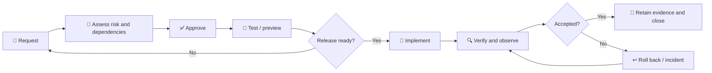

## 🎯 Purpose
---
  

This guide defines how production changes are classified, approved, implemented, verified, rolled back, and evidenced. Technical steps remain in the relevant deployment or publication guide.

[[_TOC_]]

## 🗂️ Change classification
---
  

| Type | Examples | Primary authority |
| --- | --- | --- |
| Publication | New PDF/announcement, withdrawal, metadata correction | [📄 Uploading Documents](/ADMINISTERED-WEBSITES/WEBSITES-\(Azure\)/Deployments/📄-Uploading-Documents) |
| Frontend | Public text, layout, branding, accessibility, client JavaScript | [🚀 Website Deployment](/ADMINISTERED-WEBSITES/WEBSITES-\(Azure\)/Deployments/🚀-Website-Deployment) |
| Function | API behavior, dependencies, runtime, Storage integration | [⚙️ Azure Function Deployment](/ADMINISTERED-WEBSITES/WEBSITES-\(Azure\)/Deployments/⚙️-Azure-Function-Deployment) |
| Infrastructure | Front Door, WAF, hosting, Storage, network, monitoring, identity | Authoritative IaC/platform process |
| DNS/domain | MarkMonitor records, custom domain, validation, certificate | L2/L3 domain process |
| Emergency | Urgent restoration, security containment, regulatory publication/withdrawal | Formal emergency-change process |
  

## 📝 Minimum change record
---
  

Every production change records:

  

- Business reason, scope, affected components, owner, implementer, and planned window.

- User, regulatory, security, availability, network, cost, and recovery impact.

- Dependencies, conflicts, service-health check, and stakeholder communications.

- Test plan/results and required Legal/Compliance, application, platform, security, domain, and release approvals.

- Production validation, observation period, rollback trigger, method, artifact, and authorised operator.

- Final result, incident/exception references, evidence location, and documentation updates.

  

## ✅ Approval matrix
---
  

| Impact | Required approval |
| --- | --- |
| Public wording or document | Legal/Compliance and content owner |
| Application behavior | Application/code owner |
| Azure platform, network, or recovery | Cloud platform owner |
| WAF, identity, secrets, or security control | Security owner |
| DNS or domain | L2/L3 and domain owner |
| Production release | Designated release/service owner |
  

One person may fill multiple roles only when permitted by the organisation's segregation-of-duties model.

  

## 🔁 Standard lifecycle
---
  

  

### Before implementation

  

- Confirm no conflicting change, service incident, or content freeze.

- Confirm approvers, implementers, rollback operator, and support are available.

- Confirm target environment and current baseline.

- Confirm credentials, rollback artifacts, monitoring access, and communications.

- Freeze unrelated changes for high-risk or deadline-sensitive releases.

  

### During implementation

  

- Follow the approved plan and smallest safe scope.

- Record timestamps, commands/actions, package/commit/configuration IDs, and deviations.

- Keep monitoring open and stop at the approved rollback trigger.

- Do not expose credentials in evidence.

  

### After implementation

  

- Verify website, API, representative documents, origin health, WAF, TLS/DNS, Function dependencies, and deployment state as applicable.

- Observe for the agreed period and obtain business/content acceptance.

- Reconcile configuration and documentation.

- Store evidence and close only when monitoring is stable.

  

Use [✅ Testing and Acceptance Checklist](/ADMINISTERED-WEBSITES/WEBSITES-\(Azure\)/Governance/✅-Testing-and-Acceptance-Checklist) for major releases.

  

## 🏗️ Infrastructure, network, and WAF changes
---
  

1. Update authoritative IaC where available and review the plan/diff.

2. Assess availability, security, routing, DNS, cost, data, and recovery effects.

3. Obtain platform and security approval.

4. Define health baseline, maintenance window, validation, and rollback.

5. Apply the approved configuration.

6. Validate all affected routes, private dependencies, logs, alerts, and security controls.

7. Reconcile any manual change into IaC or the controlled inventory.

8. Update [⚙️ Infrastructure Configuration Reference](/ADMINISTERED-WEBSITES/WEBSITES-\(Azure\)/Architecture/⚙️-Infrastructure-Configuration-Reference) and [🏗️ Solution Architecture](/ADMINISTERED-WEBSITES/WEBSITES-\(Azure\)/Architecture/🏗️-Solution-Architecture) when topology or controls change.

  

For a WAF exclusion, record the exact rule, narrow scope, justification, approver, owner, creation date, expiry/review date, and post-change monitoring. Never disable the policy globally for a local false positive.

  

## 🌍 DNS and domain changes
---
  

1. Confirm the exact current and proposed records, target, TTL, custom-domain state, and certificate dependency.

2. Capture rollback values and expected propagation.

3. Obtain Azure validation records where required.

4. Submit a scoped request to L2/L3 through MarkMonitor.

5. Implement in the approved window.

6. Validate multiple DNS resolvers, TLS, Front Door routing, WAF, website, and API.

7. Retain the request, approvals, before/after values, propagation evidence, and renewal ownership.

  

Do not combine unrelated DNS changes.

  

## ↩️ Rollback policy
---
  

Rollback when required content becomes inaccessible, unapproved content is exposed, availability or latency breaches the agreed threshold, routing/WAF blocks valid traffic, security controls weaken unexpectedly, or validation cannot finish within the window.

  

| Component | Approved rollback pattern |
| --- | --- |
| Frontend | Revert through Git and redeploy the previous revision |
| Function | Redeploy the previous approved run-from-package ZIP |
| Publication | Execute the explicitly authorised withdrawal/replacement process |
| Infrastructure | Reapply the previous approved IaC/configuration |
| WAF | Restore the previous approved policy/rule configuration |
| DNS | Submit recorded previous values through L2/L3 and MarkMonitor |
  

Verify and observe after rollback. Keep the failed-change or incident record open until stability and ownership are confirmed.

  

## 🚨 Emergency change
---
  

Emergency status is limited to urgent regulatory, availability, or security need; it does not remove content approval or credential-handling controls.

  

1. Declare the emergency, severity, owner, and decision authority.

2. Capture the current state, risk, smallest safe action, and rollback.

3. Obtain the fastest approval permitted by policy.

4. Implement and verify immediately with monitoring open.

5. Notify stakeholders and preserve evidence.

6. Complete retrospective review, missing approvals/evidence, and documentation promptly.

7. Reconcile manual configuration into the authoritative source.

  

## 📁 Release evidence
---
  

Retain, as applicable: change request; pull request and reviews; commit/workflow run; Function package/deployment ID; IaC plan/apply result; Azure Activity Log references; DNS/MarkMonitor request; content approval; test result; production verification; monitoring query/dashboard references; rollback result; exceptions; and final acceptance.

  

## 📋 Closure checklist
---
  

- [ ] Scope, risk, owner, and target were confirmed.

- [ ] Required approvals and test evidence were recorded.

- [ ] Rollback trigger, artifact, operator, and access were ready.

- [ ] Production was verified through the public edge.

- [ ] Monitoring remained stable for the observation period.

- [ ] Configuration and documentation were reconciled.

- [ ] Evidence was stored without secrets.

- [ ] Change was accepted, rolled back, or transferred to incident management.