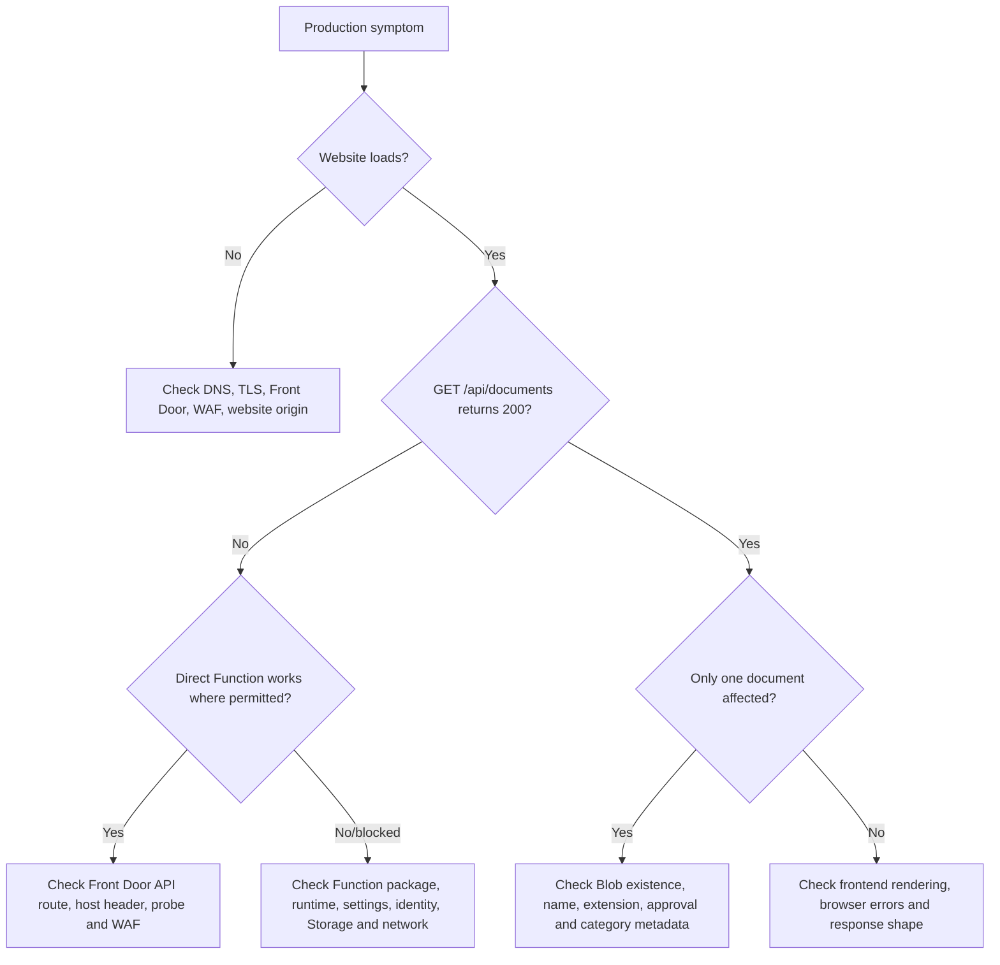

## 🎯 Purpose

  

Use this guide to triage and recover failures affecting the public website, API, publications, deployment, DNS/TLS, or Azure dependencies. Follow the organisation's formal incident policy when it imposes stricter classification, communication, evidence, or escalation requirements.

[[_TOC_]]
  

## 🚨 First response

  

1. Record detection time, reporter, affected URLs, symptoms, and user/regulatory impact.

2. Assign an incident owner and severity.

3. Preserve HTTP status, timestamps, correlation/tracking IDs, deployment IDs, logs, and screenshots without secrets or personal data.

4. Check Azure Service Health and GitHub status.

5. Notify Legal/Compliance immediately when required information is unavailable, wrong, unapproved, or confidential.

6. Freeze related releases/publications unless the incident owner authorises recovery work.

7. Avoid improvised DNS changes, global WAF disablement, embedded credentials, or unapproved Blob metadata changes.

  

## 🏷️ Suggested severity

  

| Severity | Typical example |

| --- | --- |

| Critical | Production domain unavailable; all required documents inaccessible; confidential/unapproved content public; active security compromise |

| High | Document API unavailable; major category missing; TLS failure; repeated release failure near a regulatory deadline |

| Medium | One approved document unavailable; incorrect metadata; degraded performance; preview environment failure affecting a planned release |

| Low | Cosmetic issue with no material access or compliance impact |

  

Escalate when scope grows, recovery exceeds target, evidence indicates compromise, or regulatory impact becomes likely.

  

## 🩺 Initial diagnostic path

  

From an approved workstation:

  

```powershell

curl.exe -I https://eslasa.lu

curl.exe -i https://eslasa.lu/api/documents

curl.exe -i https://func-eslalu-prod-001.azurewebsites.net/api/documents

Resolve-DnsName eslasa.lu

```

  

Direct Function access may be intentionally restricted. Correlate results with Front Door health, origin restrictions, Function logs, and the known architecture.

  



  

## 🌐 Website unavailable

  

Check in order:

  

1. DNS answer and expected Front Door target.

2. Front Door custom-domain validation and TLS certificate.

3. Front Door endpoint, route, origin group, and health probe.

4. WAF logs for unexpected blocks or policy changes.

5. Static Web App deployment state and origin restrictions.

6. Recent frontend, Front Door, WAF, DNS, certificate, or network changes.

  

Recover by rolling back the responsible approved change or escalating the Azure/platform incident. Do not bypass the edge by pointing public DNS directly to an origin without formal security and change approval.

  

## 🔌 Website loads but documents fail

  

Check:

  

- Browser request and response for `/api/documents`.

- Front Door `/api/*` route, origin group, host header, health probe, cache, and WAF logs.

- Function application/startup logs and active package.

- Presence of the required Function settings; do not expose their values in incident evidence.

- Managed identity status and Blob data-plane role assignment.

- Storage availability, firewall, private endpoint, route, NSG, and DNS resolution.

  

If the direct Function route works but Front Door fails, focus on edge routing and origin controls. If both fail, focus on Function, identity, Storage, and network dependencies.

  

## 📄 One document is missing or incorrect

  

Verify the Blob exists in the intended production container and check:

  

- `.pdf` or `.txt` extension.

- Exact `approved=true` metadata.

- Supported category.

- Simple filename accepted by the API.

- Publication date, optional display name, and announcement description.

- Public API response is current and the upload targeted production.

  

Do not alter production metadata until the content owner authorises the exact action. For incorrect or confidential content, follow the content-incident procedure below.

  

## 🔢 API response diagnosis

  

| Result | Meaning / checks |

| --- | --- |

| `400` document request | Identifier has unsupported extension, path separator, traversal sequence, quote/control character, or exceeds 255 characters |

| `404` document request | Blob missing, unapproved, renamed/withdrawn, or request targets the wrong environment |

| `500` listing/download | Missing configuration, identity/token failure, RBAC denial, Storage/network/DNS failure, runtime/startup issue, or incomplete package |

| `200` with wrong list | Publication target/metadata mismatch, stale edge behavior, or unexpected Blob content; preserve the response before changes |

  

The API intentionally gives the same `404` response for missing and unapproved content.

  

## ⚙️ Old code or startup failure

  

The Function uses run-from-package. Check:

  

1. Deployment used ZipDeploy/config-zip.

2. A new package exists in `/home/data/SitePackages`.

3. `packagename.txt` points to the intended package.

4. ZIP root contains Function and package files plus production `node_modules/`.

5. Node runtime satisfies the application requirement.

6. Worker recycling has completed; allow approximately 30–60 seconds.

  

Do not edit loose Kudu `wwwroot` files. Rebuild or roll back using [Azure Function Deployment](Azure-Function-Deployment.md).

  

## 🚀 Deployment failure

  

### Frontend

  

- Review the GitHub Actions job and target commit.

- Confirm the protected Static Web App deployment secret exists and is current.

- Confirm `/app`, empty API/output locations, and skipped build.

- Check Static Web Apps service and deployment history.

  

### Function

  

- Review ZipDeploy output, package size/structure, target, and operator permission.

- Review deployment, startup, and dependency logs.

- Confirm runtime and package activation.

  

Do not repeatedly redeploy until packaging, credential, configuration, network, or platform failure has been distinguished.

  

## 🛡️ WAF false positive

  

1. Capture path, timestamp, Front Door tracking data, and client IP only where permitted.

2. Identify the exact WAF rule and confirm the request is legitimate.

3. Design the narrowest exclusion or rule change.

4. Obtain Security approval and define expiry/review date.

5. Apply through change control, test, monitor, and record the decision.

  

Never disable the WAF globally to resolve one request.

  

## 🌍 DNS or certificate failure

  

Check DNS records and TTL through L2/L3/MarkMonitor, Front Door custom-domain validation, CNAME/alias target, certificate provisioning/expiry, domain renewal, and recent changes. Record propagation results from more than one resolver.

  

All corrections follow the L2/L3 MarkMonitor path. Account for DNS propagation in recovery estimates.

  

## 🔐 Incorrect or confidential public document

  

1. Classify as a content/security incident and notify Legal/Compliance immediately.

2. Preserve the public response, Blob properties/metadata, approval record, access evidence where available, and timeline.

3. Obtain explicit withdrawal authority.

4. Have an authorised Storage operator perform only the approved withdrawal action.

5. Verify the file is no longer listed or downloadable through the public edge.

6. Assess notification, regulatory, privacy, and security obligations.

7. Publish a corrected version only after approval.

8. Record exposure, decisions, recovery, root cause, and preventive actions.

  

## ✅ Recovery and closure

  

Before closure:

  

- [ ] Website, API, and affected documents are verified externally.

- [ ] Front Door, WAF, Function, Storage, and deployment telemetry are stable.

- [ ] Legal/Compliance confirms content status where relevant.

- [ ] Temporary controls are removed or formally accepted with owner/review date.

- [ ] Timeline, communications, evidence, and final impact are stored.

- [ ] Root cause and corrective/preventive actions have owners and due dates.

- [ ] Monitoring, tests, architecture, or runbooks are updated when a gap contributed.

- [ ] A post-incident review is scheduled when required.