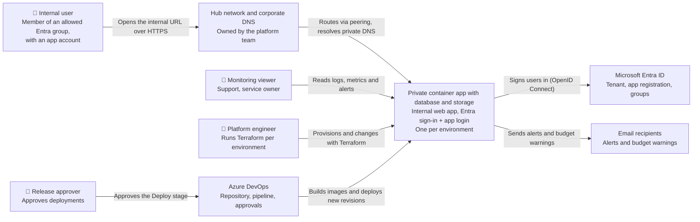
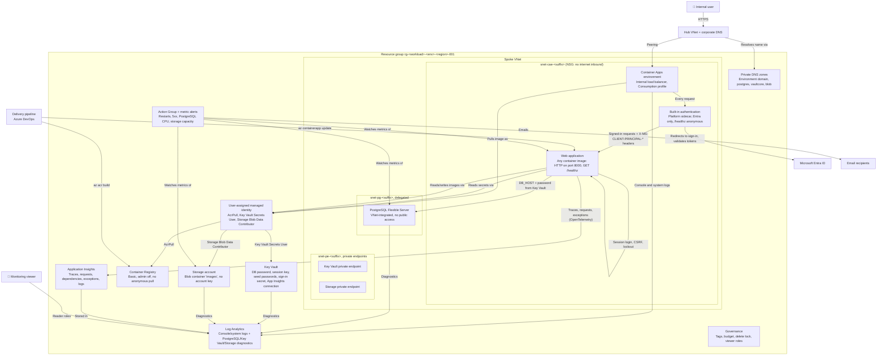
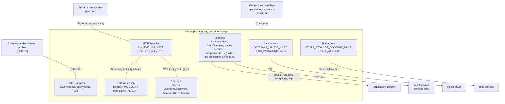
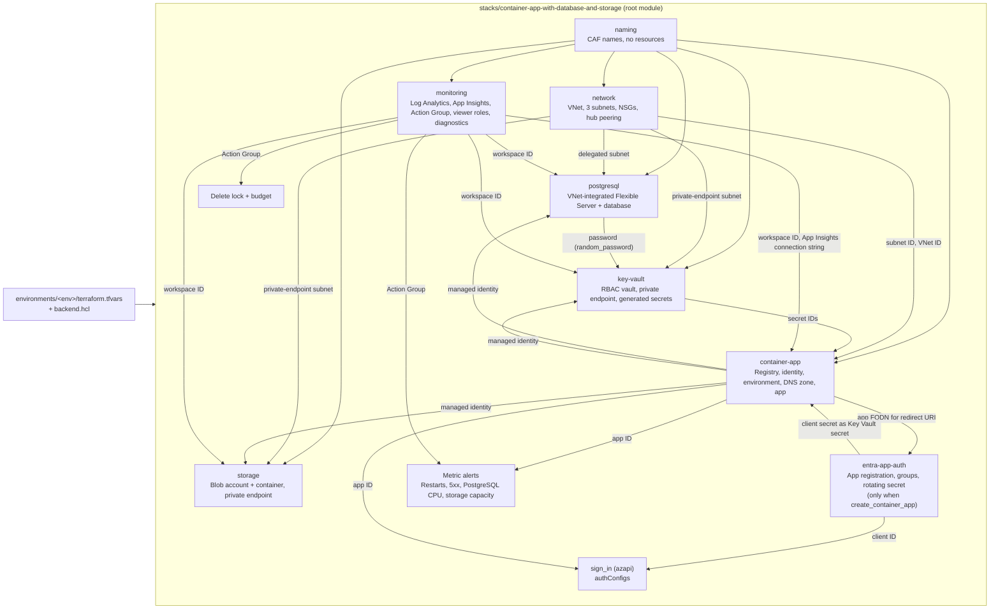
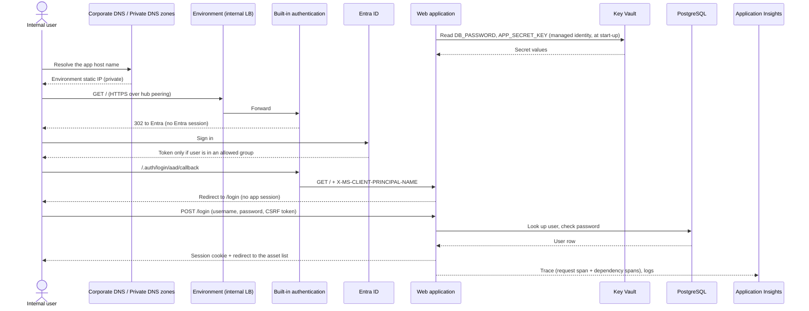
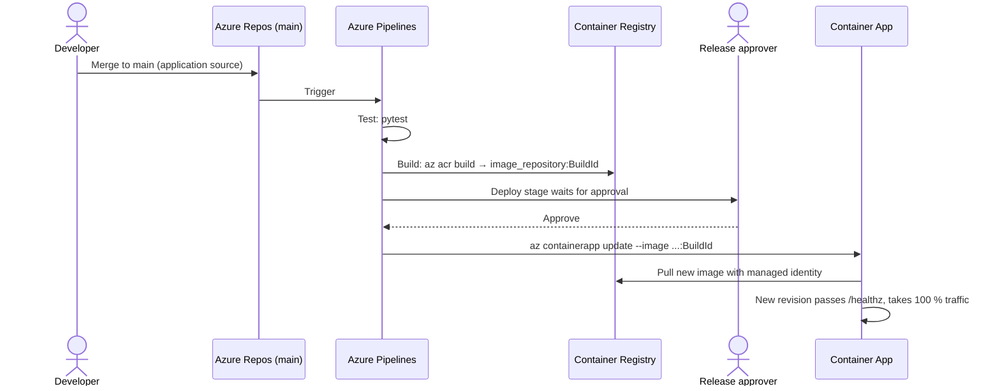
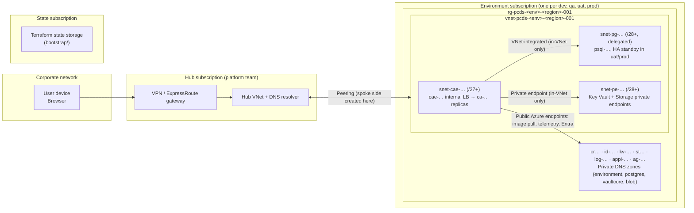

# Privately accessible container app with database and storage: C4 architecture

The system context and container views are also drawn in draw.io: [c4-context.drawio](c4-context.drawio) and [c4-containers.drawio](c4-containers.drawio).

## 1. Scope

This document covers the **privately accessible container app with database and storage** design:

- the Terraform in `infrastructure/privately-accessible-container-app-with-database-and-storage/`
- the web application it hosts, which is **generic**: any container image that meets the contract in section 6.1, speaking to PostgreSQL and Blob storage the way the example does. `content/python-crud-app/` is only the example workload
- its delivery pipeline, `infrastructure/privately-accessible-container-app-with-database-and-storage/pipelines/azure-pipelines.yml`

It serves **internal users only**: members of the Entra groups listed in `allowed_group_ids`, reaching the app from the corporate network, then signing in a second time with the app's own username/password login. Nothing is reachable from the internet. One copy of the system runs per environment (dev, qa, uat, prod), each in its own subscription with its own state.

**Inside the boundary:** the spoke network (three subnets), the Container Apps environment and app, the Private DNS zones, the registry, PostgreSQL Flexible Server, the storage account, the Key Vault, the managed identity, monitoring, the Entra app registration, and the governance resources (lock, budget, role assignments).

**Outside the boundary:**

- the hub network, its gateway and the corporate DNS (owned by the platform team)
- the Entra ID tenant and its groups
- Azure DevOps (pipeline, service connection, approvals)
- notification endpoints (email)
- the Terraform state storage (created once by `bootstrap/`)
- whoever runs `terraform apply` for the Key Vault's first write — needs data-plane network access to it, from inside the spoke or via `key_vault_allowed_ip_ranges`

The web application is a placeholder for whatever the consuming team runs. The infrastructure only requires an image that listens on port 8000, answers `GET /healthz`, and reads its database and storage connection details from environment variables the way section 6.1 describes; nothing in the Terraform depends on the application's language or framework.

## 2. Observations from the codebase

| Evidence | What it shows |
| --- | --- |
| `stacks/container-app-with-database-and-storage/main.tf` | Root module composing 8 modules, plus the sign-in config (azapi), four metric alerts, a delete lock and a budget |
| `modules/network` | Spoke VNet, three subnets: `/27`+ delegated to `Microsoft.App/environments`, `/28`+ delegated to `Microsoft.DBforPostgreSQL/flexibleServers`, `/28`+ (undelegated) for private endpoints; each with its own NSG denying `Internet` inbound |
| `modules/postgresql` | PostgreSQL Flexible Server, VNet-integrated (no public network access), `check` block refusing `postgresql_ha_enabled` on a Burstable SKU (mirrored at the stack level so it's testable) |
| `modules/key-vault` | RBAC-only Key Vault, private endpoint, `network_acls { default_action = "Deny" }`; the deploying identity gets Key Vault Secrets Officer, the container app's identity gets Key Vault Secrets User |
| `modules/storage` | Storage account with `shared_access_key_enabled = false` and `public_network_access_enabled = false`; the container app's identity gets Storage Blob Data Contributor |
| `stacks/…/main.tf`, `random_password` × 4 | DB password, Flask session key, and both seed users' passwords, generated by Terraform and written into the Key Vault module's `secrets` map |
| `modules/container-app`, `secrets` variable | Each secret is either a plain value or a `key_vault_secret_id`, wired to the container app's `secret` block with the app's managed identity for the Key Vault ones |
| `modules/container-app`, `internal_load_balancer_enabled = true` | Container Apps environment (workload profiles, Consumption) with no public IP |
| `modules/container-app`, `azurerm_container_registry` | Basic registry, `admin_enabled = false`, `anonymous_pull_enabled = false`; the app pulls with a user-assigned identity holding `AcrPull` |
| `modules/container-app`, `create_container_app` | Two-pass first deployment: platform (including the database, storage and Key Vault) first, then the app once an image exists |
| `azapi_resource.sign_in` | Built-in authentication: redirect to Entra when unauthenticated, only `/healthz` excluded, tenant-scoped v2.0 issuer |
| `modules/entra-app-auth` | Single-tenant app registration (`AzureADMyOrg`), `app_role_assignment_required = true`, default-role assignment per allowed group, client secret rotating every 180 days |
| `modules/monitoring` | Log Analytics, workspace-based Application Insights, Action Group, viewer roles, plus diagnostic settings and alerts for PostgreSQL (CPU), Key Vault and Storage (capacity) |
| `environments/<env>/terraform.tfvars` | dev, qa, uat, prod; `postgresql_ha_enabled`/`storage_replication_type` step up with `enable_delete_lock` and the budget in uat/prod |
| `pipelines/azure-pipelines.yml` | Test (pytest) → Build (`az acr build`, tag = build ID) → Deploy (`az containerapp update`) behind an environment approval; OIDC service connection |
| `content/python-crud-app/app/db.py`, `storage.py` | The example app: PostgreSQL via `DATABASE_URL`/`DB_HOST` env vars (falls back to SQLite), Blob storage via `AZURE_STORAGE_ACCOUNT_NAME` (falls back to a local folder) — both fall back cleanly so it runs with no Azure resources for local dev and tests |
| `content/python-crud-app/app/auth/security.py` | The app's own session login, CSRF and lockout — independent of, and behind, the Entra header the platform already injects |

## 3. Assumptions and inferences

- **Inferred:** users reach the spoke through VPN, ExpressRoute or office connectivity routed via the hub, same as the sibling template. The code creates only the spoke side of the peering; the hub side and the routing are the platform team's.
- **Inferred:** corporate DNS resolves the environment domain, and the platform DNS team also needs no action for the PostgreSQL/Key Vault/Storage private DNS zones, since those are created and linked entirely within this stack (spoke and, when set, hub) — nothing there depends on the platform team beyond the same hub link the environment domain already needs.
- **Inferred:** Terraform's own network path to the Key Vault's data plane (to write the generated secrets) is either a self-hosted agent inside the spoke, or a temporary public IP allow-list via `key_vault_allowed_ip_ranges` — this stack does not create that path itself.
- **Observed but untested:** nothing has been planned or applied against Azure; only `terraform validate` and `terraform test` with mocked providers have passed.

## 4. System context (C4 level 1)

## 5. Containers (C4 level 2)

A C4 "container" here means a runnable or data-holding unit, not only a Docker container.

| Container | Technology | Responsibility |
| --- | --- | --- |
| Container Apps environment | Azure Container Apps, workload profiles, internal LB | Private ingress on the environment's static IP, TLS termination, scaling, probes |
| Built-in authentication | Container Apps `authConfigs` | Forces Entra sign-in before any request reaches the app; only allowed groups get a token |
| Web application | Any container image, 1 vCPU / 2 GiB, 1 replica by default | The team's own workload; its own username/password login and CRUD (example: `content/python-crud-app/`) |
| PostgreSQL Flexible Server | Azure Database for PostgreSQL, VNet-integrated | The app's relational data, reachable only from the delegated subnet |
| Storage account | Azure Blob Storage, private endpoint | The app's image files, reachable only from the private-endpoint subnet, no account key |
| Key Vault | Azure Key Vault, RBAC, private endpoint | Holds every generated secret the app and the sign-in config need |
| Private DNS zones | Azure Private DNS | Wildcard record for the environment domain, plus resolution for PostgreSQL/Key Vault/Storage's private endpoints; all linked to spoke and hub |
| Container Registry | ACR Basic | Stores images built by ACR Tasks |
| Managed identity | User-assigned identity | Lets the app pull images, read secrets, and read/write blobs without any stored credential |
| Log Analytics / Application Insights | Azure Monitor | Platform and resource diagnostics; distributed traces, requests, dependencies, exceptions and app logs; alert source |
| Action Group + alerts | Azure Monitor | Restart, 5xx, PostgreSQL CPU and storage-capacity alerts, plus budget notifications |

## 6. Components

### 6.1 Web application: the workload contract

The web application is generic, so it has no fixed internal components beyond what every consumer needs to provide. What is fixed is the contract between any image and the platform around it.

| Contract | Why |
| --- | --- |
| Listen on port 8000 over HTTP | `container_port` in `modules/container-app`; ingress terminates TLS |
| Answer `GET /healthz` quickly and without either sign-in layer | Liveness and readiness probes, and the only path excluded from Entra authentication |
| Take the platform identity from `X-MS-CLIENT-PRINCIPAL-*` headers; add the app's own login on top | Built-in authentication has already signed the user in at the network-position layer; the app decides who can do what |
| Connect to PostgreSQL with `DATABASE_URL` or `DB_HOST`/`DB_USER`/`DB_PASSWORD`/`DB_NAME`; fall back to SQLite when unset | Matches the credential the Terraform module writes; the fallback keeps local dev and tests free of any Azure dependency |
| Read and write images with `AZURE_STORAGE_ACCOUNT_NAME` and a managed identity, never an account key; fall back to a local folder when unset | Matches `shared_access_key_enabled = false`; the fallback again keeps tests hermetic |
| Read configuration from environment variables | `app_settings` in tfvars and container app secrets; nothing environment-specific in the image |
| Log to stdout; send telemetry when `APPLICATIONINSIGHTS_CONNECTION_STRING` is set | Console logs reach Log Analytics; traces, requests, dependencies, exceptions and logs reach Application Insights |
| Run as a non-root user | Least privilege inside the container |

The example, `content/python-crud-app/`, is a Flask app that meets every row: SQLAlchemy over `psycopg`, `azure-storage-blob` with `DefaultAzureCredential`, and a hand-rolled session login. Its own structure is documented in its README.

### 6.2 Terraform stack (infrastructure components)

For engineers reusing the template, the root module `stacks/container-app-with-database-and-storage` is the unit that gets applied; the modules are its components.

## 7. Dynamic views

### 7.1 A user opens the app and it reads its secrets

### 7.2 A change is delivered

## 8. Deployment view

## 9. Risks and open questions

- **Request time limit.** Container Apps ingress ends requests after 240 seconds, and the application server may cut them sooner: the example image's gunicorn uses `--timeout 120`. Long jobs need the Blob-and-download-link pattern the sibling template's README describes.
- **Hub connectivity is a prerequisite.** Without the hub side of the peering, routing from the corporate network, and corporate DNS for the environment domain, nobody can reach the app. Agree these with the platform team before the first apply.
- **Egress uses public endpoints.** The registry (Basic) and Application Insights are reached over public endpoints, protected by Entra and keys only; PostgreSQL, Key Vault and Storage are private-only. If policy requires private-only traffic everywhere, move to a Premium registry with a private endpoint and an Azure Monitor Private Link Scope.
- **Single database credential.** Terraform and the app share one PostgreSQL administrator credential (see the README's Design decisions table). Add a scoped role if a second consumer of the database ever appears.
- **Key Vault's first-apply reach.** The vault is private-endpoint-only by design, but Terraform must reach its data plane once to write the generated secrets — either `key_vault_allowed_ip_ranges` opens a temporary public hole, or the pipeline needs a self-hosted agent inside the spoke.
- **Delete lock and resilience depend on tfvars.** The stack enforces nothing on its own: uat and prod are protected, and get HA/GZRS, only because their `terraform.tfvars` say so. A validation tying these to the environment name would make the rule hold by construction.
- **Client secret rotation.** The sign-in secret rotates every 180 days on the next apply. An environment that goes unapplied for longer than about 210 days will stop signing users in.
- **Open question:** who approves production deployments, and should the Deploy stage exist once per environment or be promoted through qa and uat first? (Same open question as the sibling template.)
