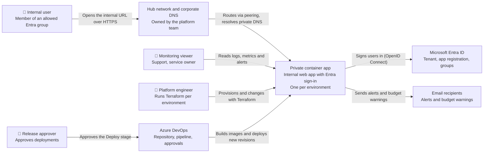
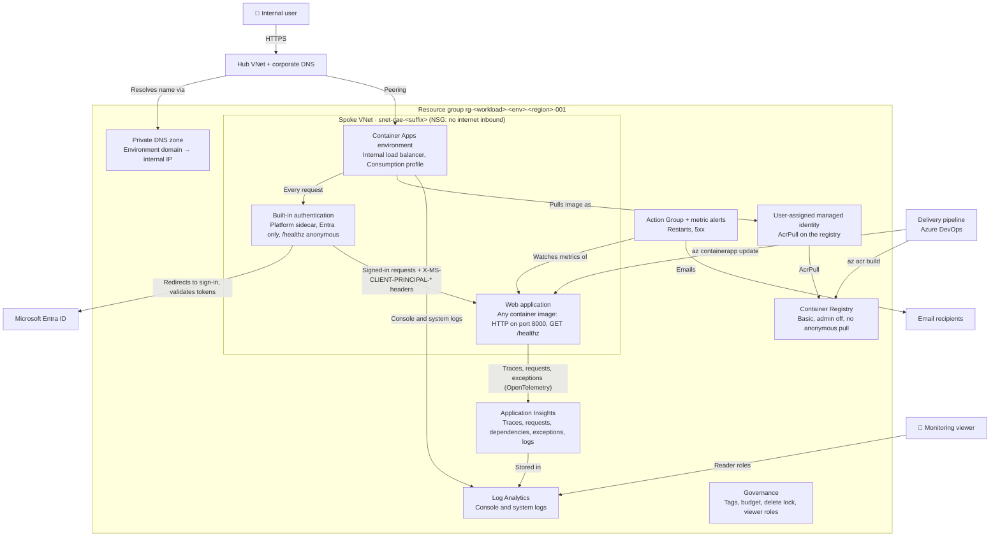
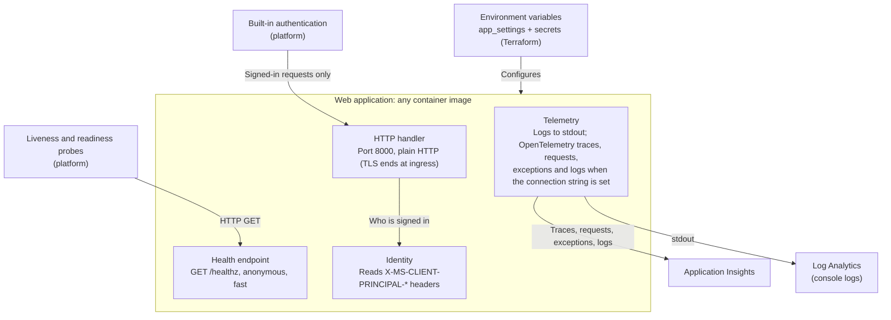
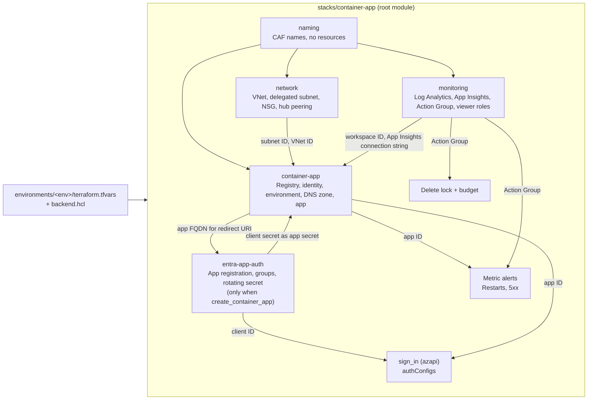
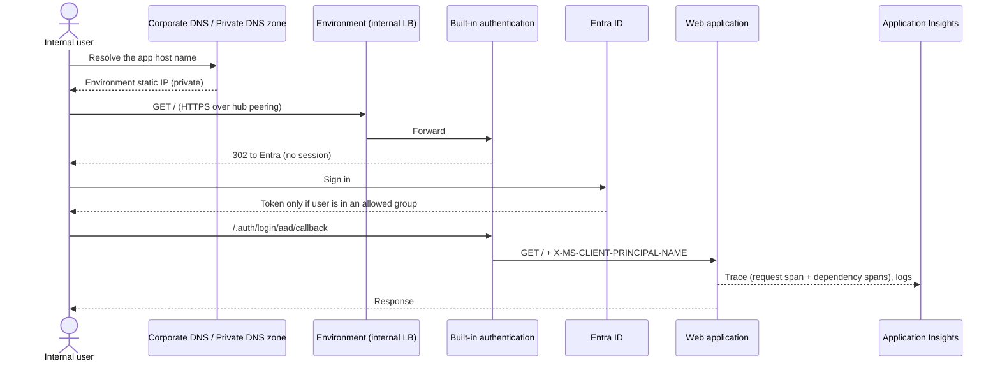
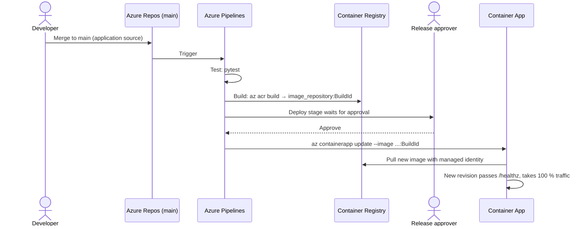
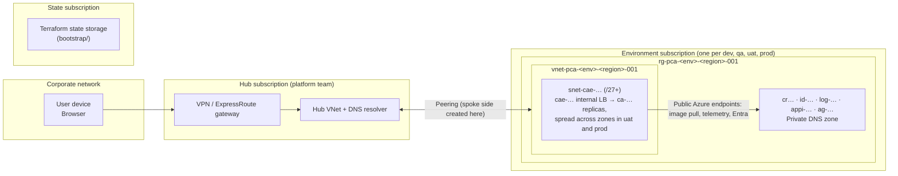

# Privately accessible container app: C4 architecture

The system context and container views are also drawn in draw.io: [c4-context.drawio](c4-context.drawio) and [c4-containers.drawio](c4-containers.drawio).

## 1. Scope

This document covers the **privately accessible container app** design:

- the Terraform in `infrastructure/privately-accessible-container-app/`
- the web application it hosts, which is **generic**: any container image that meets the contract in section 6.1. `content/python-mvc-app/` is only the example workload
- its delivery pipeline, `infrastructure/privately-accessible-container-app/pipelines/azure-pipelines.yml`

It serves **internal users only**: members of the Entra groups listed in `allowed_group_ids`, reaching the app from the corporate network. Nothing is reachable from the internet. One copy of the system runs per environment (dev, qa, uat, prod), each in its own subscription with its own state.

**Inside the boundary:** the spoke network, the Container Apps environment and app, the Private DNS zone, the registry, the managed identity, monitoring, the Entra app registration, and the governance resources (lock, budget, role assignments).

**Outside the boundary:**

- the hub network, its gateway and the corporate DNS (owned by the platform team)
- the Entra ID tenant and its groups
- Azure DevOps (pipeline, service connection, approvals)
- notification endpoints (email)
- the Terraform state storage (created once by `bootstrap/`)

The web application is a placeholder for whatever the consuming team runs. The infrastructure only requires an image that listens on port 8000 and answers `GET /healthz`; nothing in the Terraform depends on the application's language, framework or features.

## 2. Observations from the codebase

| Evidence | What it shows |
| --- | --- |
| `stacks/container-app/main.tf` | Root module composing 5 modules, plus the sign-in config (azapi), two metric alerts, a delete lock and a budget |
| `modules/network` | Spoke VNet, one `/27`+ subnet delegated to `Microsoft.App/environments`, NSG allowing 80/443 from `VirtualNetwork` and denying `Internet` inbound, optional spoke-side peering to the hub with optional gateway transit |
| `modules/container-app`, `internal_load_balancer_enabled = true` | Container Apps environment (workload profiles, Consumption) with no public IP |
| `modules/container-app`, `azurerm_private_dns_zone` + `*` A record | The environment's default domain resolves to its internal static IP; the zone is linked to the spoke and, when set, the hub |
| `modules/container-app`, `azurerm_container_registry` | Basic registry, `admin_enabled = false`, `anonymous_pull_enabled = false`; the app pulls with a user-assigned identity holding `AcrPull` |
| `modules/container-app`, `ignore_changes = [...image]` | Terraform sets only the first image; the pipeline owns every later image |
| `modules/container-app`, `create_container_app` | Two-pass first deployment: platform first, then the app once an image exists |
| `azapi_resource.sign_in` | Built-in authentication: redirect to Entra when unauthenticated, only `/healthz` excluded, tenant-scoped v2.0 issuer |
| `modules/entra-app-auth` | Single-tenant app registration (`AzureADMyOrg`), `app_role_assignment_required = true`, default-role assignment per allowed group, client secret rotating every 180 days |
| `modules/monitoring` | Log Analytics (PerGB2018), workspace-based Application Insights, Action Group with email receivers, `Reader` + `Monitoring Reader` + `Log Analytics Reader` for viewer groups |
| `azurerm_monitor_metric_alert` × 2 | `RestartCount > 0` and more than 5 `5xx` requests in 15 minutes, both to the Action Group |
| `azurerm_consumption_budget_resource_group` | Budget alerts at 80 % actual and 100 % forecast, to emails and the Action Group |
| `environments/<env>/terraform.tfvars` | dev, qa, uat, prod; `enable_delete_lock = true` and a higher budget in prod |
| `pipelines/azure-pipelines.yml` | Test (pytest) → Build (`az acr build`, tag = build ID) → Deploy (`az containerapp update`) behind an environment approval; OIDC service connection |
| `modules/container-app`, probes and `target_port` | The only things the platform asks of the image: HTTP on port 8000 (`container_port`) and `GET /healthz` (`health_path`) for liveness and readiness |
| `stacks/container-app`, `app_settings` + secrets | The app receives plain settings as environment variables, plus `APPLICATIONINSIGHTS_CONNECTION_STRING` from a container app secret |
| `content/python-mvc-app/` (example only) | A Flask app that meets the contract: trusts `X-MS-CLIENT-PRINCIPAL-NAME`, logs to stdout, sends OpenTelemetry traces, requests and logs when the connection string is set, keeps no local state |

## 3. Assumptions and inferences

- **Inferred:** users reach the spoke through VPN, ExpressRoute or office connectivity routed via the hub. The code creates only the spoke side of the peering; the hub side and the routing are the platform team's.
- **Inferred:** corporate DNS resolves the environment domain either through the hub VNet link this template creates or through a conditional forwarder the platform team adds. The `environment_dns` output exists for that hand-over.
- **Inferred:** outbound traffic from the environment (image pulls from the registry, telemetry to Application Insights, token validation against Entra) leaves over Azure's default outbound path to public endpoints. Nothing in the code adds private endpoints, a NAT gateway or forced tunnelling for egress.
- **Observed but untested:** nothing has been planned or applied against Azure; only `terraform validate` and `terraform test` with mocked providers have passed.

## 4. System context (C4 level 1)

## 5. Containers (C4 level 2)

A C4 "container" here means a runnable or data-holding unit, not only a Docker container.

| Container | Technology | Responsibility |
| --- | --- | --- |
| Container Apps environment | Azure Container Apps, workload profiles, internal LB | Private ingress on the environment's static IP, TLS termination, scaling, probes |
| Built-in authentication | Container Apps `authConfigs` | Forces Entra sign-in before any request reaches the app; only allowed groups get a token |
| Web application | Any container image, 1 vCPU / 2 GiB, 1 replica by default | The team's own workload; should be stateless (example: `content/python-mvc-app/`) |
| Private DNS zone | Azure Private DNS | Wildcard record for the environment domain, linked to spoke and hub |
| Container Registry | ACR Basic | Stores images built by ACR Tasks |
| Managed identity | User-assigned identity | Lets the app pull images without registry credentials |
| Log Analytics / Application Insights | Azure Monitor | Platform logs; distributed traces, requests, dependencies, exceptions and app logs; alert source |
| Action Group + alerts | Azure Monitor | Restart and 5xx alerts, budget notifications |

## 6. Components

### 6.1 Web application: the workload contract

The web application is generic, so it has no fixed internal components. What is fixed is the contract between any image and the platform around it. Keep to it and the template works unchanged.

| Contract | Why |
| --- | --- |
| Listen on port 8000 over HTTP | `container_port` in `modules/container-app`; ingress terminates TLS |
| Answer `GET /healthz` quickly and without sign-in | Liveness and readiness probes, and the only path excluded from authentication |
| Take the user from `X-MS-CLIENT-PRINCIPAL-*` headers; never handle passwords or tokens | Built-in authentication has already signed the user in |
| Read configuration from environment variables | `app_settings` in tfvars and container app secrets; nothing environment-specific in the image |
| Log to stdout; send telemetry when `APPLICATIONINSIGHTS_CONNECTION_STRING` is set | Console logs reach Log Analytics; traces (with the W3C `traceparent` header propagated), requests, dependencies, exceptions and logs reach Application Insights |
| Keep no local state; finish each request within 240 seconds | Replicas can be replaced or scaled out at any time; the ingress request limit is 240 seconds |
| Run as a non-root user | Least privilege inside the container |

The example, `content/python-mvc-app/`, is a Flask app in MVC style that meets every row. Its own structure is documented in its README.

### 6.2 Terraform stack (infrastructure components)

For engineers reusing the template, the root module `stacks/container-app` is the unit that gets applied; the modules are its components.

## 7. Dynamic views

### 7.1 A user opens the app

### 7.2 A change is delivered

## 8. Deployment view

## 9. Risks and open questions

- **Request time limit.** Container Apps ingress ends requests after 240 seconds, and the application server may cut them sooner: the example image's gunicorn uses `--timeout 120`. Each team should check its own server timeout; long jobs need the Blob-and-download-link pattern in the README.
- **Hub connectivity is a prerequisite.** Without the hub side of the peering, routing from the corporate network, and corporate DNS for the environment domain, nobody can reach the app. Agree these with the platform team before the first apply. Linking the zone to the hub VNet needs rights in the hub subscription; a conditional forwarder avoids that.
- **Egress uses public endpoints.** The registry (Basic) and Application Insights are reached over public endpoints, protected by Entra and keys only. If policy requires private-only traffic, move to a Premium registry with a private endpoint and an Azure Monitor Private Link Scope, as the private static website template already does.
- **Telemetry uses a connection string.** Application Insights accepts the instrumentation key rather than Entra auth. Consider local-auth-off with the managed identity granted `Monitoring Metrics Publisher`.
- **Delete lock depends on tfvars.** The stack enforces nothing: uat and prod are protected only if `enable_delete_lock = true` is set in their tfvars. A validation tying the lock to the environment would make the governance rule hold by construction.
- **Replicas and zones.** uat and prod run 2 replicas in a zone-redundant environment; dev and qa run 1 and are not highly available. Zone redundancy is fixed at creation, so decide it before the first apply of each environment. `APP_SECRET_KEY` is random per process, which only matters if sessions are ever added.
- **Client secret rotation.** The sign-in secret rotates every 180 days on the next apply. An environment that goes unapplied for longer than about 210 days will stop signing users in.
- **Open question:** who approves production deployments, and should the Deploy stage exist once per environment or be promoted through qa and uat first?
