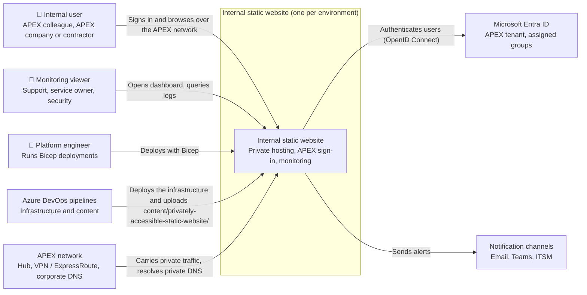
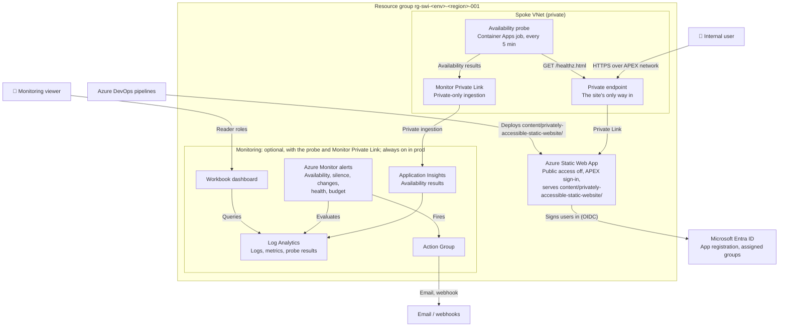
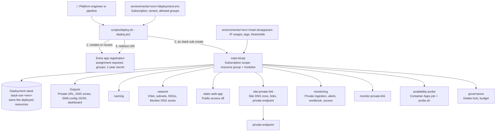

# Privately accessible static website (Bicep): C4 architecture

The C4 model for this template is below (levels 1 to 3), and the same levels 1 and 2 are available as draw.io diagrams in this folder:

- [c4-context.drawio](c4-context.drawio): C4 level 1
- [c4-containers.drawio](c4-containers.drawio): C4 level 2

The same C4 model is published as a page at `content/privately-accessible-static-website/architecture.html`.

## 1. Scope

This document covers:
- the Bicep in `infrastructure/privately-accessible-static-website-bicep/`
- the site in `content/privately-accessible-static-website/`
- its delivery pipelines (`pipelines/azure-pipelines-infra.yml`, `pipelines/azure-pipelines-content.yml`)

It serves **internal users only**: anyone signing in with APEX Entra ID, meaning colleagues, people from APEX companies, and contractors. It has no internet exposure.

**Outside the boundary:**
- the APEX hub network and corporate DNS
- the APEX Entra ID tenant
- notification endpoints
- Azure DevOps, which runs the pipelines

## 2. Observations from the codebase

| Evidence | What it shows |
| --- | --- |
| `main.bicep` (`targetScope = 'subscription'`) | Creates the resource group, then composes 8 modules in it |
| `modules/static-web-app.bicep` with `publicNetworkAccessEnabled: false` | The Static Web App refuses public traffic |
| `modules/site-private-link.bicep` + `modules/private-endpoint.bicep`, subresource `staticSites` | The only way in is a private endpoint in `snet-pe-<suffix>`, with the site's own Private DNS zone |
| `modules/network.bicep` | Spoke VNet, a private-endpoint subnet, a probe subnet delegated to `Microsoft.App/environments`, NSGs denying `Internet` inbound, Azure Monitor Private DNS zones, optional hub peering |
| `scripts/deploy.sh` | Creates the single-tenant app registration with assignment required, assigns groups, creates a 1-year secret, sets the redirect URI |
| `main.bicep` output `staticWebAppConfigJson` | Every route requires `authenticated` except `/healthz.html`; a 401 redirects to `/.auth/login/aad`; tenant-scoped OpenID issuer |
| `modules/monitor-private-link.bicep` | Azure Monitor Private Link Scope with private-only ingestion |
| `modules/monitoring.bicep` with `internetIngestionEnabled: false` | Log Analytics and Application Insights accept telemetry only through Private Link |
| `modules/availability-probe.bicep` + `probe.sh` | Scheduled Container Apps job (every 5 min) inside the VNet that requests `/healthz.html` and posts an `AvailabilityData` record to Application Insights |
| `modules/governance.bicep` | Delete lock (uat, prod) and budget |
| `environments/<env>/` | dev, qa, uat, prod, each with its own subscription, network range and deployment stack |

## 3. Assumptions and inferences

- **Inferred:** users reach the site from the corporate network through VPN, ExpressRoute or office connectivity routed via the APEX hub. The code only offers optional hub peering and DNS links (`hubVirtualNetworkId`); how the hub routes users is outside this repository.
- **Inferred:** static-site deployment still works with public network access disabled, because uploads go through the Static Web Apps deployment service rather than the site host. **Verify in dev.**
- **Observed but untested:** nothing has been deployed to Azure, and the Bicep compiler was not available when the template was written, so it has not been built or linted either.

## 4. System context (C4 level 1)

## 5. Containers (C4 level 2)

**Not drawn:** Private DNS zones (`privatelink.<n>.azurestaticapps.net` and the five Azure Monitor zones), the NSGs on both subnets, and the deployment stack that owns all of this.

## 6. Components: the Bicep template (C4 level 3)

| Module | Responsibility |
| --- | --- |
| `naming` | Resource names, including `vnet-`, `ampls-`, `pe-stapp-` and `app-` |
| `network` | Spoke VNet, the two subnets, NSGs, Azure Monitor Private DNS zones, optional hub peering and DNS links |
| `static-web-app` | Standard tier with public network access disabled, plus sign-in client ID and secret in app settings |
| `site-private-link` | The site's Private DNS zone (named from the site's partition), its VNet and hub links, and the private endpoint |
| `private-endpoint` | Generic private endpoint with a DNS zone group; used for the site and for Azure Monitor |
| `monitoring` | Log Analytics and App Insights (private ingestion), probe availability and silence alerts, change, health and budget alerts, workbook, viewer and operator roles |
| `monitor-private-link` | Azure Monitor Private Link Scope linked to Log Analytics and App Insights, with its private endpoint |
| `availability-probe` | Internal-only Container Apps environment and one scheduled job per test |
| `governance` | Delete lock in uat and prod, and the resource-group budget |

## 7. Prerequisites for deployment

Everything that must be in place before the first deployment. Nothing has been deployed to Azure yet, so dev is the first real test. The step-by-step is in [README.md](README.md#how-to-use-it-step-by-step).

### Tools

- Azure CLI with `az bicep` and `az stack sub`
- Bash or PowerShell, to run `scripts/deploy.sh` or `scripts/deploy.ps1`
- Git, with access to this repository
- For Azure DevOps: a project, service connections, environments and a variable group ([README](README.md#deploy-with-azure-devops-step-by-step))

### Azure subscriptions

- **Recommended:** one subscription per environment (dev, qa, uat, prod).
- **Minimum:** production in its own subscription; dev, qa and uat may share one. If they share:
  - set `enableServiceHealthAlert = true` in only one of them, or every Azure incident is alerted once per environment
  - set `exportActivityLog = true` in at most one of them
  - scope the deploying identity to each resource group, because Contributor on the shared subscription reaches all three environments
- A region where Static Web Apps is available: `westus2`, `centralus`, `eastus2`, `westeurope` or `eastasia`.
- A billing type that supports budgets (EA, MCA or pay-as-you-go), or `monthlyBudget = 0`.
- These resource providers registered: Microsoft.Web, Microsoft.Network, Microsoft.App, Microsoft.Insights, Microsoft.OperationalInsights, Microsoft.AlertsManagement and Microsoft.Consumption.

### Identity that deploys

A person or a pipeline service principal with:

- **Contributor** and **User Access Administrator** on the subscription
- **Network Contributor** on the hub VNet, if `hubVirtualNetworkId` is set
- **Entra ID rights** to create app registrations and assign groups to them (Application Developer or Cloud Application Administrator, or Microsoft Graph `Application.ReadWrite.OwnedBy` and `AppRoleAssignment.ReadWrite.All` for a pipeline), or an administrator who creates the app registration for you

### Values to set

- In `deployment.env`: `SUBSCRIPTION_ID`, `TENANT_ID`, `ALLOWED_GROUP_IDS`
- In `main.bicepparam`: `governanceTags`, the three IP ranges, `dnsServers`, optionally `hubVirtualNetworkId`, alert receivers, viewer and operator groups, budget

### Specific to this design

From the APEX platform team:

- free IP ranges for the spoke VNet and its two subnets
- the hub side of the peering (this template creates only the spoke side)
- corporate DNS that resolves the zones in the `privateDnsZones` output
- a decision on the Azure Monitor Private DNS zones: this template's own, or the landing zone's central zones

Also:

- **User connectivity:** VPN, ExpressRoute or office connectivity routed through the hub.
- **Probe image:** outbound internet to pull it from MCR, or a copy in an APEX container registry set as `probeImage`.
- **Deployment path:** verify in dev that uploads work with public network access disabled; if not, the content pipeline needs a self-hosted agent inside the VNet.
- **Secret expiry:** the client secret lasts one year and is replaced on every deploy, so each environment must be redeployed within a year.

## 8. Open questions

1. **Network:** will the APEX platform team provide the hub peering, corporate DNS forwarding and IP ranges? Or should this design move to their central Private DNS zones (golden-template step 3)?
2. **App registrations:** may the pipeline create app registrations in the APEX tenant (Graph permissions), or must an administrator pre-create them?
3. **Dashboard access:** should viewers open the dashboard only from the APEX network (`monitoringQueryFromInternet = false`)?
4. **Probe image:** is pulling it from MCR acceptable, or must it come from an APEX container registry?
5. **Build agents:** may Microsoft-hosted agents deploy the site, or must a self-hosted agent inside the network be provided?

## 9. Risks and mismatches

- **Deployment path unproven:** deploying with public network access disabled is not yet proven. If uploads fail, the content pipeline needs a self-hosted agent inside the VNet.
- **Health page is anonymous:** `/healthz.html` needs no sign-in. It is reachable only from the private network and contains no content.
- **Monitor DNS takeover:** creating the Azure Monitor `privatelink.*` zones in this spoke changes how Azure Monitor names resolve for anything using this VNet. In a landing zone with central zones, this must switch to those zones.
- **Secret expiry:** the client secret lasts one year, so each environment must be redeployed within a year to keep sign-in working.
- **App registration outside the stack:** deleting the deployment stack leaves the Entra app registration behind.
- **Unbuilt template:** the template has not been compiled or linted; the first build may surface errors to fix.
