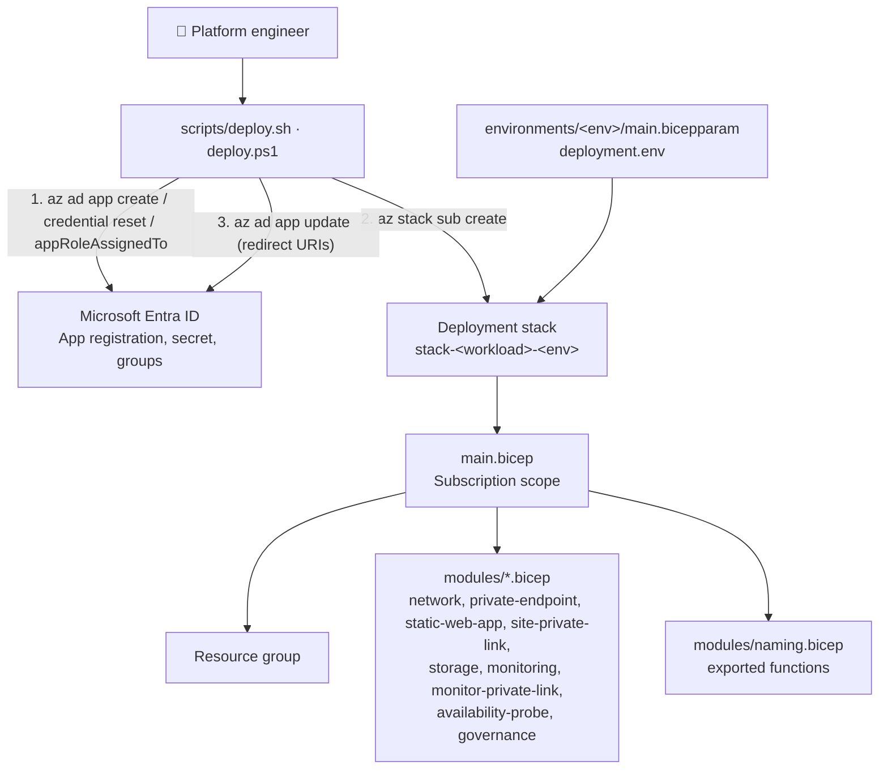

# Privately accessible static website with storage (Bicep): architecture

This template deploys the same architecture as [../privately-accessible-static-website-with-storage](../privately-accessible-static-website-with-storage), with Bicep instead of Terraform. The C4 model (system context, containers, components of the file library) is in that template's [ARCHITECTURE.md](../privately-accessible-static-website-with-storage/ARCHITECTURE.md); the diagrams here are the same files:

- [c4-context.drawio](c4-context.drawio): level 1, the system, its people and the systems around it
- [c4-containers.drawio](c4-containers.drawio): level 2, the Azure resources of one environment

Each Terraform module in that document has a Bicep file; the table in the [README](README.md) maps one to the other. Keep both templates and the diagrams in step when the architecture changes.

## What is different in Bicep

| Observation | Where |
| --- | --- |
| A deployment stack per environment replaces Terraform state; uat and prod add deny-delete | `scripts/deploy.sh` |
| The Entra app registration, its secret and its group assignments are made by the script, because Bicep's Microsoft Graph extension cannot create client secrets | `scripts/deploy.sh`, `deploy.ps1` |
| The Static Web App's private DNS zone is created in its own module, because its name depends on the app's host name, which is only known after the app exists | `modules/site-private-link.bicep` |
| Resource names come from exported functions, because a resource name must be known when the deployment starts | `modules/naming.bicep` |
| Prod forces monitoring and malware scanning on | `main.bicep` (`monitoringOn`, `malwareScanningOn`) |

**Status:** `bicep build` and the linter pass. Nothing has been deployed to Azure.
