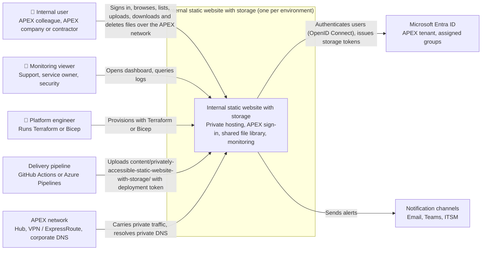
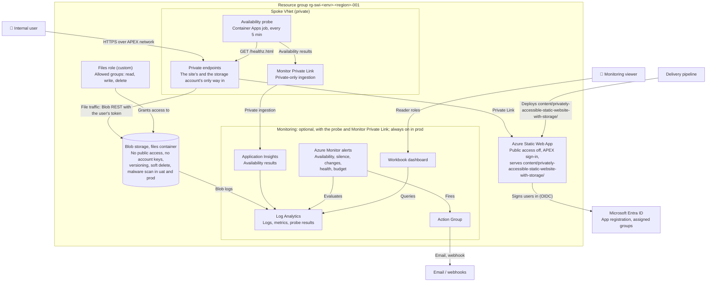
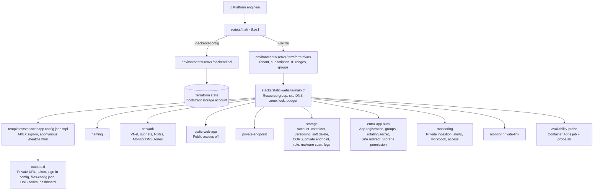

# Privately accessible static website with storage: C4 architecture

Diagrams in draw.io: [c4-context.drawio](c4-context.drawio) (level 1) and [c4-containers.drawio](c4-containers.drawio) (level 2).

The page at `content/privately-accessible-static-website-with-storage/architecture.html` is inherited from the design without storage and does **not** yet show the file library; this document and the draw.io files are the current model.

## 1. Scope

This document covers the **privately accessible design with a file library**:
- the Terraform in `infrastructure/privately-accessible-static-website-with-storage/`
- the site in `content/privately-accessible-static-website-with-storage/`
- its delivery pipelines (`.github/workflows/deploy-internal-static-web-app-with-storage.yml`, `infrastructure/privately-accessible-static-website-with-storage/pipelines/azure-pipelines.yml`)

It serves **internal users only**: anyone signing in with APEX Entra ID, meaning colleagues, people from APEX companies, and contractors. It has no internet exposure. Signed-in users share one file library in private Blob storage; there is no database and no server code. The design without storage is documented in `infrastructure/privately-accessible-static-website/ARCHITECTURE.md`, and the public design in `infrastructure/publicly-accessible-static-website/ARCHITECTURE.md`. A Bicep version of this design is in `infrastructure/privately-accessible-static-website-with-storage-bicep/`.

**Outside the boundary:**
- the APEX hub network and corporate DNS
- the APEX Entra ID tenant
- notification endpoints
- the Terraform state storage (created by `bootstrap/`)

## 2. Observations from the codebase

| Evidence | What it shows |
| --- | --- |
| `stacks/static-website/main.tf` | Root module composing 9 modules, plus the site's Private DNS zone, delete lock and budget |
| `modules/storage` | One StorageV2 account with `public_network_access_enabled = false` and `shared_access_key_enabled = false`, a private `files` container, versioning, blob and container soft delete, a CORS rule limited to the site's origins, a private endpoint (`blob`), a custom role at the container, optional Defender malware scanning and blob diagnostics |
| `stacks/static-website/tests/storage.tftest.hcl` | Mocked-provider checks that the account is never public and keyless, that the blob DNS zone exists with monitoring off, and that malware scanning cannot be off in prod |
| `modules/entra-app-auth` (second redirect) | A single-page-app redirect `https://<site>/files.html` and the delegated Azure Storage `user_impersonation` permission, so the page can act as the signed-in user |
| `content/.../files.html`, `files.js`, `vendor/msal-browser.min.js` | The page gets the user's token with MSAL.js and calls the Blob REST API (list, put, get, delete) directly |
| `modules/static-web-app` with `public_network_access_enabled = false` | The Static Web App refuses public traffic |
| `modules/private-endpoint`, subresource `staticSites` | The only way in is a private endpoint in `snet-pe-<suffix>` |
| `modules/network` | Spoke VNet, a private-endpoint subnet, a probe subnet delegated to `Microsoft.App/environments`, NSGs denying `Internet` inbound, Azure Monitor Private DNS zones, optional hub peering |
| `modules/entra-app-auth` | Single-tenant app registration (`AzureMyOrg`), `app_role_assignment_required = true`, group assignments, secret rotating every 180 days |
| `templates/staticwebapp.config.json.tftpl` | Every route requires `authenticated` except `/healthz.html`; a 401 redirects to `/.auth/login/aad`; tenant-scoped OpenID issuer; the content security policy allows connections only to the site, `login.microsoftonline.com` and the storage account |
| `modules/monitor-private-link` | Azure Monitor Private Link Scope with `ingestion_access_mode = "PrivateOnly"` |
| `modules/monitoring` with `internet_ingestion_enabled = false` | Log Analytics and Application Insights accept telemetry only through Private Link |
| `modules/availability-probe` + `probe.sh` | Scheduled Container Apps job (every 5 min) inside the VNet that requests `/healthz.html` and posts an `AvailabilityData` record to Application Insights |
| `environments/<env>/` | dev, qa, uat, prod, each with its own subscription, network range and state key |

## 3. Assumptions and inferences

- **Inferred:** users reach the site from the corporate network through VPN, ExpressRoute or office connectivity routed via the APEX hub. The code only offers optional hub peering and DNS links (`hub_virtual_network_id`); how the hub routes users is outside this repository.
- **Inferred:** static-site deployment still works with public network access disabled, because uploads go through the Static Web Apps deployment service rather than the site host. **Verify in dev.**
- **Inferred:** a custom role carrying `blobs/tags/read` is enough for the page to list blobs with `include=tags` (to hide malware-flagged files). **Verify in dev.**
- **Inferred:** the Azure Storage `user_impersonation` permission ID in `entra-app-auth` is correct and an admin can consent to it. **Verify in dev.**
- **Observed but untested:** nothing has been applied to Azure; only `terraform validate` and the mocked `terraform test` suites have passed, and `files.js` has not been run in a browser.

## 4. System context (C4 level 1)

## 5. Containers (C4 level 2)

**How the file traffic flows:** the browser, not the Static Web App, calls Blob storage. `files.js` gets the user's own token with MSAL.js and sends it to the blob endpoint, which Private DNS resolves to the storage private endpoint. The Static Web App only serves the page.

**Not drawn:** Private DNS zones (`privatelink.<n>.azurestaticapps.net` and the five Azure Monitor zones, one of which, `privatelink.blob.core.windows.net`, also serves the storage account), and the NSGs on both subnets.

## 6. Components: the Terraform stack (C4 level 3)

| Module | Responsibility |
| --- | --- |
| `naming` | Resource names, including `vnet-`, `ampls-`, `pe-stapp-`, `pe-st-`, `role-files-` and `app-`; the storage account name carries a 4-character hash of the subscription ID |
| `network` | Spoke VNet, the two subnets, NSGs, Azure Monitor Private DNS zones, optional hub peering and DNS links |
| `static-web-app` | Standard tier with public network access disabled, plus sign-in client ID and secret in app settings |
| `private-endpoint` | Generic private endpoint with a DNS zone group; used for the site and for Azure Monitor |
| `storage` | The file library: private keyless account, `files` container, versioning, soft delete, lifecycle rule for old versions, CORS, blob private endpoint, container-scoped custom role and assignments, optional malware scanning, blob diagnostics |
| `entra-app-auth` | Single-tenant registration, web and single-page-app redirect URIs, Azure Storage delegated permission, assignment-required service principal, group assignments, rotating secret |
| `monitoring` | Log Analytics and App Insights (private ingestion), probe availability and silence alerts, change, health and budget alerts, workbook, viewer and operator roles |
| `monitor-private-link` | Azure Monitor Private Link Scope linked to Log Analytics and App Insights, with its private endpoint |
| `availability-probe` | Internal-only Container Apps environment and one scheduled job per test |

## 7. Prerequisites for deployment

Everything that must be in place before the first `terraform apply`. Nothing has been applied to Azure yet, so dev is the first real test. (For Bicep, see the README of the `-bicep` template.)

### Tools

- Terraform 1.9 or later (validated with 1.16)
- Azure CLI, to sign in with `az login`
- Bash or PowerShell, to run `scripts/tf.sh` or `scripts/tf.ps1`
- Git, with access to this repository

### Azure subscriptions

- **Recommended:** one subscription per environment (dev, qa, uat, prod).
- **Minimum:** production in its own subscription; dev, qa and uat may share one. No code change is needed, only the same `subscription_id` in their `terraform.tfvars`. If they share:
  - set `enable_service_health_alert = true` in only one of them, or every Azure incident is alerted once per environment
  - set `export_activity_log = true` in at most one of them, or in none if the subscription already exports its Activity Log
  - scope the deploying identity to each resource group, because Contributor on the shared subscription reaches all three environments
- A region where Static Web Apps is available: `westus2`, `centralus`, `eastus2`, `westeurope` or `eastasia`.
- A billing type that supports budgets (EA, MCA or pay-as-you-go), or `monthly_budget = 0`.
- These resource providers registered: Microsoft.Web, Microsoft.Network, Microsoft.App, Microsoft.Insights, Microsoft.OperationalInsights, Microsoft.AlertsManagement, Microsoft.Storage and Microsoft.Consumption. Terraform normally registers them, but locked-down subscriptions may block it.

### Terraform state

- Run `bootstrap/` once to create the state storage account.
- Copy its `backend_config` output into each `environments/<env>/backend.hcl`.

### Identity that runs Terraform

A person or a pipeline service principal with:

- **Contributor** on the subscription or resource group
- **User Access Administrator**, to grant the monitoring viewer and operator roles and the file library role (it also creates a role definition)
- **Security Admin** (or another role that can change Defender for Cloud settings), where `malware_scanning_enabled` is on
- **Storage Blob Data Contributor** on the state storage account
- **Entra ID rights** to create app registrations (Application Developer or Cloud Application Administrator). Without them, set `create_entra_app = false` and pass `existing_entra_client_id` and `existing_entra_client_secret`.
- **Network Contributor** on the hub VNet, if `hub_virtual_network_id` is set.

### Values in `environments/<env>/terraform.tfvars`

Replace every `<...>` placeholder:

- `subscription_id` and `tenant_id`
- `governance_tags`: owner, cost centre, data classification, support
- `alert_email_receivers` and `alert_webhook_receivers`
- `monitoring_viewer_principal_ids` and `monitoring_operator_principal_ids` (Entra group object IDs)
- `monthly_budget` and `budget_contact_emails` (the contacts are required when `enable_monitoring = false`)
- `allowed_group_ids`: the Entra groups allowed to sign in and use the file library
- the file library settings: `storage_replication_type`, `soft_delete_retention_days`, `malware_scanning_enabled` (must be true in prod), `max_upload_mb`, `allowed_extensions`, and `additional_site_origins` for a custom domain
- `vnet_address_space`, `private_endpoint_subnet_prefix`, `probe_subnet_prefix` (at least /27) and `dns_servers`
- optionally `hub_virtual_network_id`

### Delivery pipeline

- After the first apply, store `static_web_app_deployment_token` as `AZURE_STATIC_WEB_APPS_API_TOKEN_INTERNAL_FILES`, one per environment.
- Store the `staticwebapp_config_json` output as `SWA_CONFIG_JSON` and the `files_config_json` output as `FILES_CONFIG_JSON`, so the pipeline writes both into `content/privately-accessible-static-website-with-storage/` before uploading. The deployment token secret is `AZURE_STATIC_WEB_APPS_API_TOKEN_INTERNAL_FILES`, so it does not clash with the design without storage.
- After the first apply, an Entra admin grants consent for the Azure Storage `user_impersonation` permission on the app registration (`entra_client_id` output).
- In GitHub, create the environments used for approvals; in Azure DevOps, the variable group.

### Specific to this design

From the APEX platform team:

- free IP ranges for the spoke VNet and its two subnets
- the hub side of the peering (this stack creates only the spoke side)
- corporate DNS that resolves the zones in the `private_dns_zones` output, including `privatelink.blob.core.windows.net`
- a decision on the Azure Monitor Private DNS zones: this stack's own, or the landing zone's central zones

Also:

- **User connectivity:** VPN, ExpressRoute or office connectivity routed through the hub.
- **Probe image:** outbound internet to pull it from MCR, or a copy in an APEX container registry set as `probe_image`.
- **Deployment path:** verify in dev that uploads work with public network access disabled; if not, the pipeline needs a self-hosted runner or agent inside the VNet.
- **Secret rotation:** the client secret rotates every 180 days, so the stack must be applied at least that often; a scheduled pipeline is advisable.

## 8. Open questions

1. **Network:** will the APEX platform team provide the hub peering, corporate DNS forwarding and IP ranges? Or should this design move to their central Private DNS zones (golden-template step 3)?
2. **App registrations:** may Terraform create app registrations in the APEX tenant, or must they be pre-created (`create_entra_app = false`)?
3. **Dashboard access:** should viewers open the dashboard only from the APEX network (`monitoring_query_from_internet = false`)?
4. **Probe image:** is pulling it from MCR acceptable, or must it come from an APEX container registry?
5. **Shared access:** is one shared library where every assigned user can delete any file acceptable, or are per-team folders or a read-only group needed?
6. **Server-side checks:** is browser-only file type and size checking enough, or does the library need an API that enforces them?

## 9. Risks and mismatches

- **Deployment path unproven:** deploying with public network access disabled is not yet proven. If uploads fail, the pipeline needs a self-hosted runner or agent inside the VNet.
- **Health page is anonymous:** `/healthz.html` needs no sign-in. It is reachable only from the private network and contains no content.
- **Monitor DNS takeover:** creating the Azure Monitor `privatelink.*` zones in this spoke changes how Azure Monitor names resolve for anything using this VNet. In a landing zone with central zones, this must switch to those zones.
- **Secret rotation:** the client secret rotates every 180 days, so the stack must be applied at least that often to keep sign-in working.
- **Token in the browser:** the page holds a storage token for the signed-in user, so any script running on the page could use it. The content security policy allows only the site's own scripts, and MSAL.js is a pinned copy with an integrity hash.
- **Limits are advice:** file type and size are checked in the browser only; a user can call storage directly with their own token.
- **Shared delete rights:** everyone assigned can overwrite or delete any file. Versioning and soft delete make that recoverable, not impossible.
- **Scan gap:** a file can be downloaded in the seconds before its malware scan finishes, and the page hides a flagged file but does not delete it.
- **Stale architecture page:** `content/.../architecture.html` still describes the design without storage.
