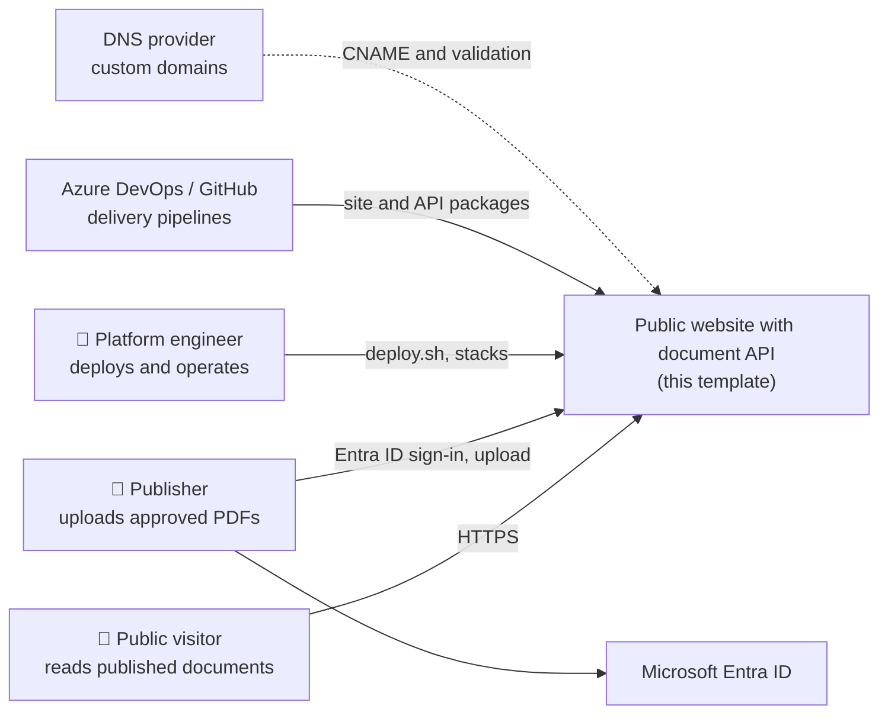
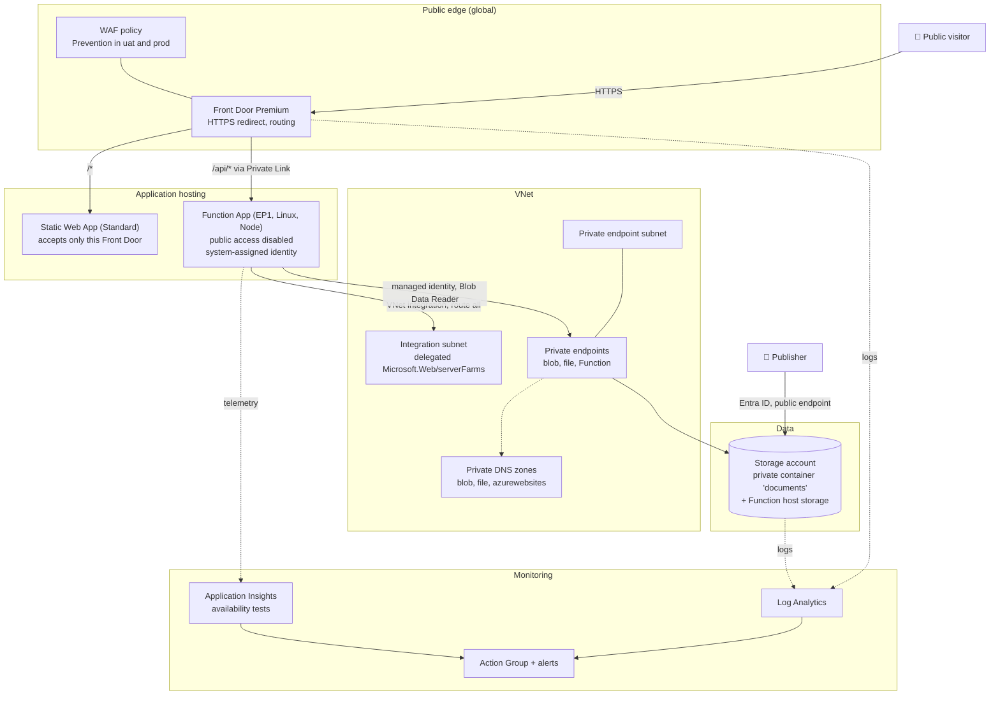
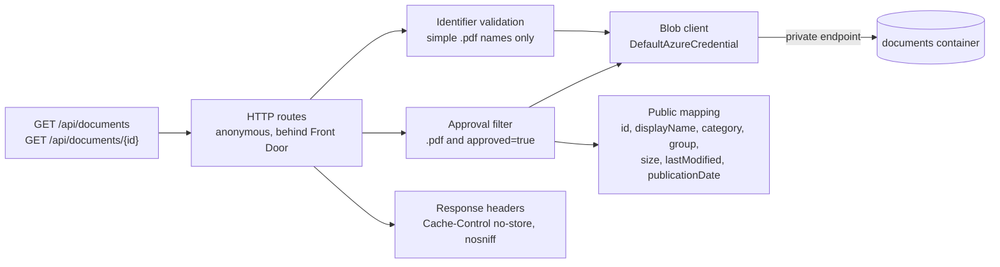
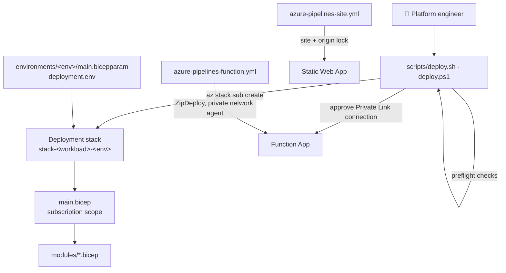

# Publicly accessible static website with a document API (Bicep): architecture

C4 model of the template, in [Mermaid](https://mermaid.js.org/). The same views are in [c4-context.drawio](c4-context.drawio) and [c4-containers.drawio](c4-containers.drawio), with Lucidchart-import copies [c4-context-lucidchart.drawio](c4-context-lucidchart.drawio) and [c4-containers-lucidchart.drawio](c4-containers-lucidchart.drawio). Keep all of them in step when the architecture changes.

## Level 1: system context

## Level 2: containers (one environment)

## Level 3: components of the Function App

The API code is not part of the template; the components above are the contract the template's permissions and routing assume: read-only access, PDFs only, 404 for missing and unapproved documents alike, no caching.

## Trust boundaries

| Boundary | Control |
| --- | --- |
| Internet → Front Door | HTTPS only with redirect, managed certificates, WAF, origin health probes |
| Front Door → Static Web App | `AzureFrontDoor.Backend` allow-list, required `X-Azure-FDID`, allowed forwarded hosts |
| Front Door → Function App | Private Link connection approved on the Function; public network access disabled |
| Function → Storage | System-assigned identity, Storage Blob Data Reader, private endpoint through VNet integration |
| Publisher → Storage | Entra ID, Storage Blob Data Contributor, anonymous access off |
| Operator → Azure | Entra ID, RBAC, delete lock and deny-delete stack in uat and prod |

## Deployment

**Status:** nothing has been built or deployed. The Bicep CLI was not available when this was written.
