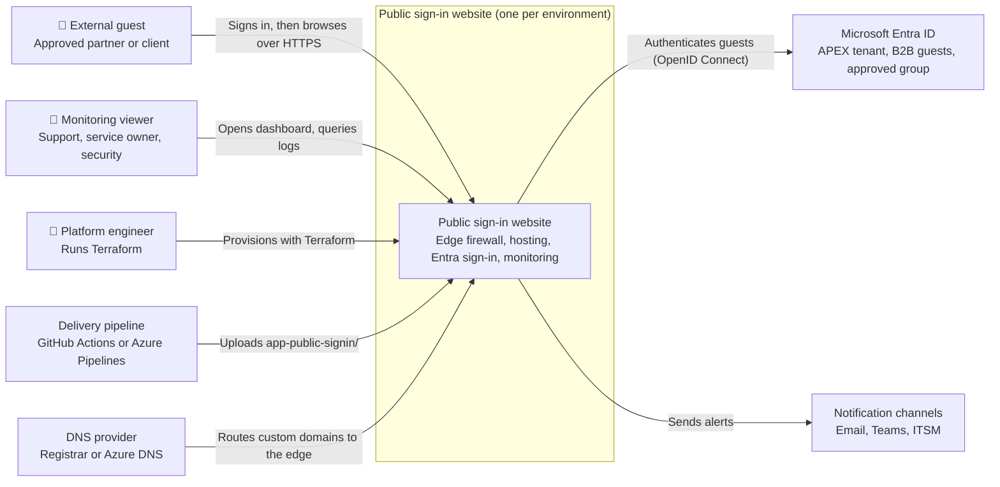
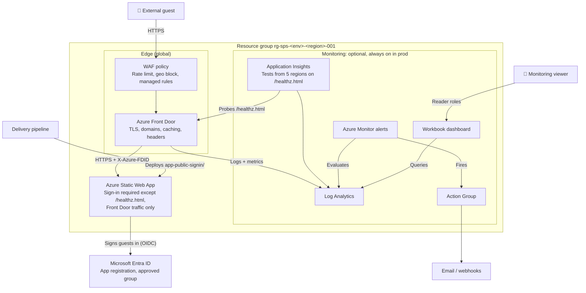
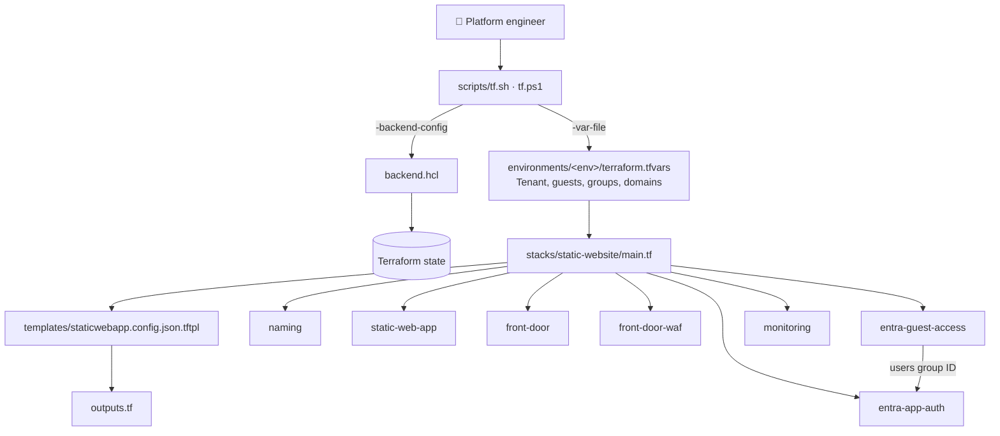

# Public sign-in static website: C4 architecture

The same C4 model is published as a page at `app-public-signin/architecture.html`.

## 1. Scope

This document covers the **public sign-in** design:
- the Terraform in `public-signin-static-website/`
- the site in `app-public-signin/`
- its delivery pipelines (`.github/workflows/deploy-public-signin-static-web-app.yml`, `azure-pipelines-public-signin.yml`)

The site is reachable from the internet, but every page except `/healthz.html` requires signing in with Entra ID. External people sign in as **B2B guests of the APEX tenant**, and only **approved groups** get in.

**Outside the boundary:**
- the APEX Entra ID tenant: guest accounts, Conditional Access, cross-tenant settings
- the DNS provider
- notification endpoints
- the Terraform state storage (`bootstrap/`)

## 2. Observations from the codebase

| Evidence | What it shows |
| --- | --- |
| `stacks/static-website/main.tf` | Root module composing 7 modules, plus the resource group, delete lock and budget |
| `modules/front-door`, `modules/front-door-waf` | Internet entry through Front Door and its WAF, the same as the publicly accessible design |
| `modules/static-web-app` + `static_web_app_sku` validation | The Standard tier is enforced, with `AZURE_CLIENT_ID` and `AZURE_CLIENT_SECRET` app settings |
| `modules/entra-app-auth` | Single-tenant (`AzureADMyOrg`) registration, redirect URIs for every public host, `app_role_assignment_required = true`, a secret rotating every 180 days |
| `modules/entra-guest-access` | Site users group, `azuread_invitation` per address in `guest_emails`, and a group membership for each invited guest |
| `templates/staticwebapp.config.json.tftpl` | Tenant-scoped OpenID issuer; `/*` needs `authenticated` except `/healthz.html`; a 401 redirects to `/.auth/login/aad`; Front Door lock (`X-Azure-FDID`, `allowedForwardedHosts`) when Front Door is enabled |
| `stacks/static-website/main.tf`, `local.availability_tests` | Internet web tests target `https://<host>/healthz.html` |
| `environments/<env>/` | dev (no Front Door), qa, uat and prod, each with its own subscription and state key |

## 3. Assumptions and inferences

- **Inferred:** guests redeem their invitation before their first sign-in. The Microsoft invitation email does this, or the `guest_invitation_links` output can be handed out.
- **Inferred:** the APEX tenant allows guest invitations and does not block the guests' home tenants in cross-tenant access settings.
- **Observed but untested:** nothing has been applied to Azure; only `terraform validate` has passed.

## 4. System context (C4 level 1)

## 5. Containers (C4 level 2)

## 6. Components: the Terraform stack (C4 level 3)

| Module | Responsibility |
| --- | --- |
| `naming` | Resource names (`sps` workload code) |
| `static-web-app` | Standard tier, with the sign-in client ID and secret in app settings |
| `front-door` | Profile, endpoint, origin, route, custom domains, security headers |
| `front-door-waf` | WAF policy and security policy for every domain |
| `entra-app-auth` | App registration, redirect URIs for every host, assignment-required service principal, group assignments, rotating secret |
| `entra-guest-access` | Site users group, B2B invitations, guest memberships |
| `monitoring` | Log Analytics, App Insights, web tests on `/healthz.html`, alerts, workbook, viewer and operator roles |

## 7. Prerequisites for deployment

Everything that must be in place before the first `terraform apply`. Nothing has been applied to Azure yet, so dev is the first real test.

### Tools

- Terraform 1.9 or later (validated with 1.16)
- Azure CLI, to sign in with `az login`
- Bash or PowerShell, to run `scripts/tf.sh` or `scripts/tf.ps1`
- Git, with access to this repository

### Azure subscriptions

- **Recommended:** one subscription per environment (dev, qa, uat, prod).
- **Minimum:** production in its own subscription; dev, qa and uat may share one. No code change is needed, only the same `subscription_id` in their `terraform.tfvars`. If they share:
  - set `enable_service_health_alert = true` in only one of them, or every Azure incident is alerted once per environment
  - set `export_activity_log = true` in at most one of them, or in none if the subscription already exports its Activity Log
  - scope the deploying identity to each resource group, because Contributor on the shared subscription reaches all three environments
- A region where Static Web Apps is available: `westus2`, `centralus`, `eastus2`, `westeurope` or `eastasia`.
- A billing type that supports budgets (EA, MCA or pay-as-you-go), or `monthly_budget = 0`.
- These resource providers registered: Microsoft.Web, Microsoft.Cdn, Microsoft.Insights, Microsoft.OperationalInsights, Microsoft.AlertsManagement, Microsoft.Storage and Microsoft.Consumption. Terraform normally registers them, but locked-down subscriptions may block it.

### Terraform state

- Run `bootstrap/` once to create the state storage account.
- Copy its `backend_config` output into each `environments/<env>/backend.hcl`.

### Identity that runs Terraform

A person or a pipeline service principal with:

- **Contributor** on the subscription or resource group
- **User Access Administrator**, to grant the monitoring viewer and operator roles
- **Storage Blob Data Contributor** on the state storage account
- **Entra ID rights** to create app registrations and groups, and to invite guests (the Guest Inviter role, or tenant settings that allow it). Without them, set `create_entra_app = false` and let the identity team create the app registration and group.

### Values in `environments/<env>/terraform.tfvars`

Replace every `<...>` placeholder:

- `subscription_id` and `tenant_id`
- `governance_tags`: owner, cost centre, data classification, support
- `alert_email_receivers` and `alert_webhook_receivers`
- `monitoring_viewer_principal_ids` and `monitoring_operator_principal_ids` (Entra group object IDs)
- `monthly_budget` and `budget_contact_emails` (the contacts are required when `enable_monitoring = false`)
- `guest_emails` and/or `allowed_group_ids`
- `custom_domains`, with `monitor = false` until DNS points at Front Door

### Delivery pipeline

- After the first apply, store `static_web_app_deployment_token` as `AZURE_STATIC_WEB_APPS_API_TOKEN_PUBLIC_SIGNIN`, one per environment.
- Store the `staticwebapp_config_json` output as `SWA_CONFIG_JSON`, so the pipeline writes it into `app-public-signin/` before uploading.
- In GitHub, create the environments used for approvals; in Azure DevOps, the variable group.

### Specific to this design

- **Tenant settings:** the APEX tenant allows guest invitations, and cross-tenant access settings do not block the partners' home tenants.
- **DNS provider access**, to create the TXT validation record and the CNAME for each custom domain.
- **Recommended:** Conditional Access requiring MFA for guests, and periodic access reviews of the site's users group.
- **Known blocker:** the first plan on a new environment fails, because the app role assignments use the ID of the guest group created in the same run. Fix `entra-app-auth` to take a map with static keys before the first deployment.
- **Secret rotation:** the client secret rotates every 180 days, so the stack must be applied at least that often; a scheduled pipeline is advisable.

## 8. Open questions

1. **Guest onboarding:** will guests be invited through `guest_emails` (Terraform), or through Entra entitlement management access packages run by the identity team?
2. **MFA for guests:** should APEX require its own MFA for guests, or trust MFA from partner tenants?
3. **Dev without Front Door:** should dev also run behind Front Door, so sign-in is tested through the same host name as production?

## 9. Risks and mismatches

- **Invitations in state:** invitations created by Terraform live in its state. Removing an address from `guest_emails` deletes the invitation resource but may not delete the guest user; offboarding should go through Entra.
- **Health page is public:** `/healthz.html` is reachable by anyone on the internet. It must stay content-free.
- **Secret rotation:** the client secret rotates every 180 days, so the stack must be applied at least that often to keep sign-in working.
- **Host names must match:** sign-in works only on host names present both in the app registration's redirect URIs and in `allowedForwardedHosts`. Adding a custom domain later needs a new apply and a config redeploy.
