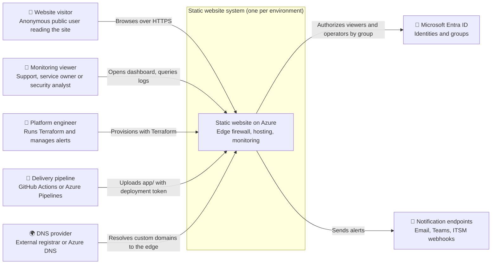
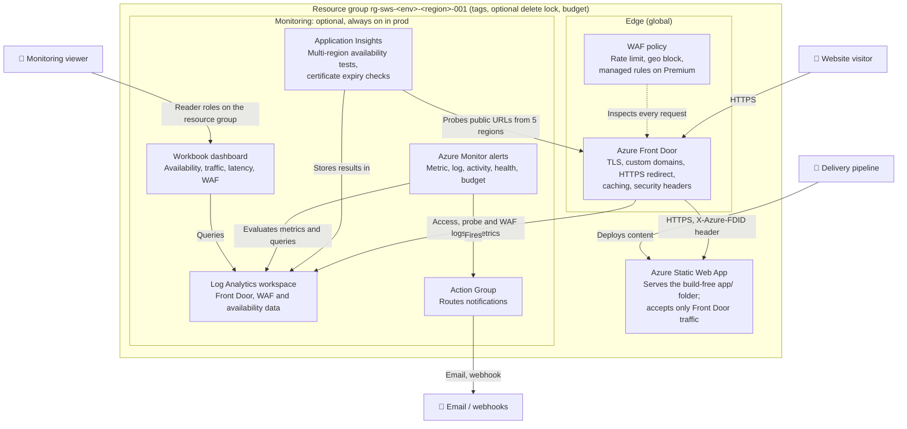
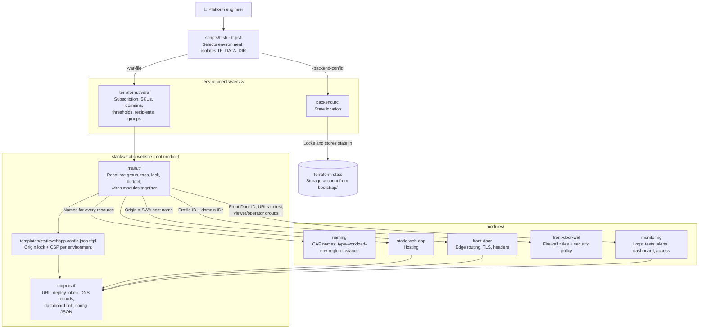

# Static website stack: C4 architecture

## 1. Scope

This document covers the Terraform stack in `publicly-accessible-static-website/` and the runtime system it provisions: a static website on Azure with an edge firewall and full monitoring, deployed once per environment (`dev`, `qa`, `uat`, `prod`).

- **Inside the boundary:** everything Terraform creates, meaning the edge, hosting, monitoring, access and governance resources.
- **Adjacent, shown for context:**
  - the site content in `app/`
  - the delivery pipelines (`.github/workflows/deploy-static-web-app.yml`, `azure-pipelines.yml`)
  - the Terraform state storage created by `publicly-accessible-static-website/bootstrap`
- **Outside the boundary:** Entra ID, the DNS provider, Azure platform services and notification endpoints. The stack consumes them but does not own them.

The architecture is the pattern in `WEBSITES-(Azure)/` without a backend: there is no Function App, Blob Storage, managed identity, private endpoint or VNet.

## 2. Observations from the codebase

| Evidence | What it shows |
| --- | --- |
| `stacks/static-website/main.tf` | One root module composes 5 modules and adds the resource group, delete lock and budget |
| `stacks/static-website/versions.tf` | Terraform >= 1.9, azurerm `~> 4.60`, empty `backend "azurerm" {}` (partial config) |
| `stacks/static-website/providers.tf` | `subscription_id` and `tenant_id` come from variables, so each environment targets its own subscription |
| `environments/<env>/terraform.tfvars` + `backend.hcl` | The same stack runs with 4 settings files and 4 state locations |
| `modules/front-door` | Front Door profile, endpoint, origin group with an HTTPS health probe, the Static Web App as the only origin, route `/*` with HTTPS redirect and caching, managed-TLS custom domains, a security-headers rule set |
| `modules/front-door-waf` | WAF policy (per-IP rate limit, optional geo block, DRS 2.1 + Bot Manager 1.1 on Premium) bound to every domain through a security policy |
| `modules/static-web-app` | Static Web App, Free or Standard, with preview environments toggle |
| `modules/monitoring` | Log Analytics, workspace-based Application Insights, standard web tests, diagnostic settings, metric/log/activity alerts, Action Group, workbook, role assignments |
| `stacks/static-website/templates/staticwebapp.config.json.tftpl` | Generated config that restricts the Static Web App to `AzureFrontDoor.Backend` + `X-Azure-FDID` and sets the CSP |
| `enable_front_door` (count on `module.front_door` / `module.waf`) | Front Door is optional per environment; dev turns it off |
| `bootstrap/main.tf` | Separate root with local state; creates the state storage account (Entra ID auth only, GRS, versioning, soft delete, lock) |
| `scripts/tf.sh`, `tf.ps1` | Operators run `tf <env> <command>`; `TF_DATA_DIR` is isolated per environment |

## 3. Assumptions and inferences

- **Inferred:** the people who run Terraform are a platform or cloud team, and the people in `monitoring_viewer_principal_ids` are support, service owners and security operations. The tfvars comments suggest this, but no roles are fixed in code.
- **Inferred:** the public audience is anonymous web visitors. There is no authentication on the site.
- **Inferred:** DNS lives outside Azure (as with MarkMonitor in the wiki), because `dns_zone_id` is optional and `custom_domain_dns_records` is emitted for manual creation.
- **Observed but unverified:** nothing has been planned or applied against Azure. Only `terraform validate` has passed.

## 4. System context

Who and what interacts with the static website system.

## 5. Container view

The runnable units inside one environment. Front Door and its WAF exist only when `enable_front_door = true`.

### Environment deployment view

The same containers are deployed four times from `environments/<env>/terraform.tfvars`. The defaults are:

| | dev | qa | uat | prod |
| --- | --- | --- | --- | --- |
| Subscription | own | own | own | own |
| Front Door | off | Standard | Premium | Premium |
| WAF | n/a | Detection | Prevention + managed rules | Prevention + managed rules |
| Static Web App | Free | Standard | Standard | Standard |
| Log retention | 30 days | 30 days | 90 days | 180 days |
| Delete lock | no | no | yes | yes |

## 6. Component view: the Terraform stack

This view breaks down the Terraform codebase itself: how the modules divide responsibility, and how configuration and state flow into one apply.

### Monitoring module internals

`modules/monitoring` is the largest module. It is split by responsibility:

| File | Responsibility |
| --- | --- |
| `main.tf` | Log Analytics workspace, workspace-based Application Insights, Action Group (email + webhooks) |
| `diagnostics.tf` | Front Door access, health probe and WAF logs + metrics to the workspace; optional subscription Activity Log export |
| `availability.tf` | Standard web test per public URL from 5 regions; fails on non-200 or a certificate within 14 days of expiry |
| `alerts.tf` | Availability, origin health, 5xx, 4xx, latency, WAF block spikes, destructive/security control-plane changes, resource health, service health |
| `workbook.tf` | Shared dashboard with 10 KQL panels over the workspace |
| `access.tf` | Viewer roles (Reader, Monitoring Reader, Log Analytics Reader) and operator roles (+ Monitoring Contributor, Workbook Contributor) on the resource group |

## 7. Prerequisites for deployment

Everything that must be in place before the first `terraform apply`. Nothing has been applied to Azure yet, so dev is the first real test.

### Tools

- Terraform 1.9 or later (validated with 1.16)
- Azure CLI, to sign in with `az login`
- Bash or PowerShell, to run `scripts/tf.sh` or `scripts/tf.ps1`
- Git, with access to this repository

### Azure subscriptions

- **Recommended:** one subscription per environment (dev, qa, uat, prod).
- **Minimum:** production in its own subscription; dev, qa and uat may share one. No code change is needed, only the same `subscription_id` in their `terraform.tfvars`. If they share:
  - set `enable_service_health_alert = true` in only one of them, or every Azure incident is alerted once per environment
  - set `export_activity_log = true` in at most one of them, or in none if the subscription already exports its Activity Log
  - scope the deploying identity to each resource group, because Contributor on the shared subscription reaches all three environments
- A region where Static Web Apps is available: `westus2`, `centralus`, `eastus2`, `westeurope` or `eastasia`.
- A billing type that supports budgets (EA, MCA or pay-as-you-go), or `monthly_budget = 0`.
- These resource providers registered: Microsoft.Web, Microsoft.Cdn, Microsoft.Insights, Microsoft.OperationalInsights, Microsoft.AlertsManagement, Microsoft.Storage and Microsoft.Consumption. Terraform normally registers them, but locked-down subscriptions may block it.

### Terraform state

- Run `bootstrap/` once to create the state storage account.
- Copy its `backend_config` output into each `environments/<env>/backend.hcl`.

### Identity that runs Terraform

A person or a pipeline service principal with:

- **Contributor** on the subscription or resource group
- **User Access Administrator**, to grant the monitoring viewer and operator roles
- **Storage Blob Data Contributor** on the state storage account

### Values in `environments/<env>/terraform.tfvars`

Replace every `<...>` placeholder:

- `subscription_id` and `tenant_id`
- `governance_tags`: owner, cost centre, data classification, support
- `alert_email_receivers` and `alert_webhook_receivers`
- `monitoring_viewer_principal_ids` and `monitoring_operator_principal_ids` (Entra group object IDs)
- `monthly_budget` and `budget_contact_emails` (the contacts are required when `enable_monitoring = false`)
- `custom_domains`, with `monitor = false` until DNS points at Front Door

### Delivery pipeline

- After the first apply, store `static_web_app_deployment_token` as `AZURE_STATIC_WEB_APPS_API_TOKEN`, one per environment.
- Store the `staticwebapp_config_json` output as `SWA_CONFIG_JSON`, so the pipeline writes it into `app/` before uploading.
- In GitHub, create the environments used for approvals; in Azure DevOps, the variable group.

### Specific to this design

- **DNS provider access**, to create the TXT validation record and the CNAME for each custom domain. An apex domain needs ALIAS/ANAME or CNAME flattening.
- **Front Door Premium** in uat and prod for the WAF managed rule sets; it is the main cost of this design.

## 8. Open questions

1. **Tokens per environment:** should each environment have its own delivery pipeline stage? The pipelines currently deploy with a single token, and the stack emits one per environment.
2. **Who writes the origin lock:** which process writes `staticwebapp_config_json` into `app/`? Until it is written, the Static Web App's default host name serves the site directly and bypasses the WAF.
3. **Who runs Terraform:** is Terraform run by a person with the wrapper script, or should a CI pipeline plan on pull requests and apply with approvals?
4. **Where alerts go:** is there a central Log Analytics workspace or SOC destination that these logs should also go to, instead of one workspace per environment?
5. **Subscriptions:** will environments really use separate subscriptions? The service-health alert is scoped to the whole subscription and would be noisy in a shared one.

## 9. Risks and mismatches

- **dev has no edge:** with `enable_front_door = false`, dev has no WAF, no Front Door alerts and empty Front Door panels. This is intentional, to save cost, but it differs from production.
- **Direct access until the origin lock ships:** see question 2.
- **Activity panel depends on export:** the workbook's "Alerts fired" panel reads `AzureActivity`, which only exists when `export_activity_log = true`.
- **Placeholders:** the tfvars and `backend.hcl` files contain placeholder subscription IDs, domains and storage names that must be replaced before any plan.

## 10. Suggested next refinements

- Add a Terraform CI pipeline (plan on PR, apply per environment with approval gates) and document it as a container in section 5.
- Extend the delivery pipelines to deploy through dev → qa → uat → prod and write the per-environment `staticwebapp.config.json`.
- Once applied, replace the inferred personas with the real Entra ID groups and record actual resource names in the wiki's configuration reference.
